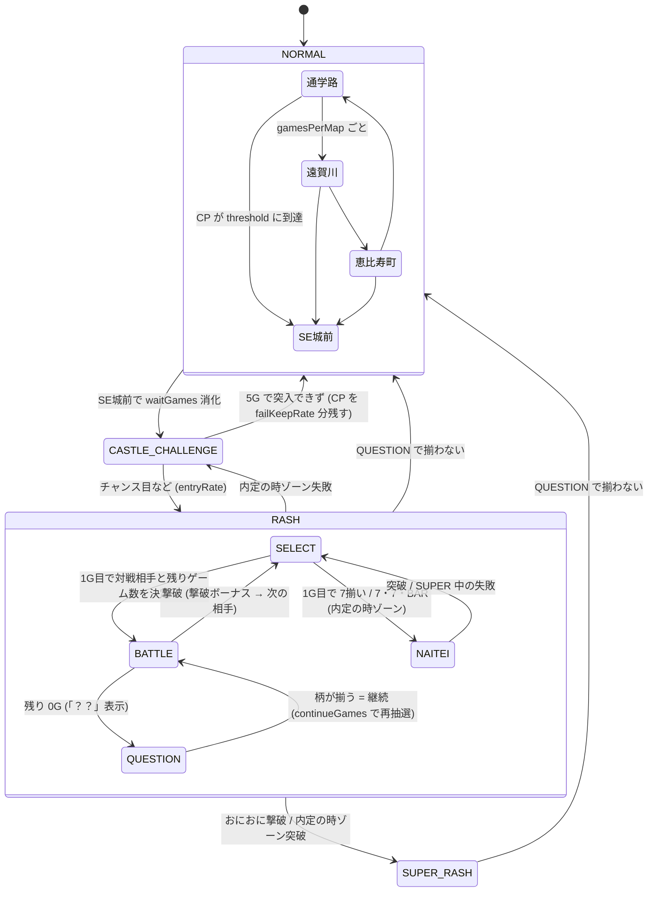

# CRこおりくんの大冒険 ～おにおにの野望～

主人公「こおりくん」が、ラスボス「おにおに」を倒すために SE城 を目指すスロットゲーム。
`slot/` の原型をもとに、液晶演出とゲーム性に特化して作り直している。

## 遊び方

- `index.html` をブラウザで直接開く（サーバー不要）
- レバー: **Space** / STOP: **J / K / L**（⚙ SETTINGS で変更可）
- `js/config.js` の `debug: true` で、画面下にデバッグパネル（状態の表示・強制遷移ボタン）が出る

## オープニング・エンディング・ともいし

- はじめて遊ぶとき（保存データがないとき）・リセットしたあと・台移動したあとに、液晶で短いストーリーを流す（`js/lcd/opening-view.js`、約15秒。ユーザー指定）
  - リセット・台移動のときは、読み込み直す前に `SaveData.requestOpening` で印（localStorage の `koori-opening`）を残し、起動時に `takeOpeningRequest` で読んで消す
  - 台移動の「○番台に移動!」・続きからの「CONTINUE!」は、オープニングが終わってから出す
  1. 遠賀川のほとりで、こおりくんは母・ともいしと平和に暮らしていた
  2. SE城の主・おにおにが現れる（ともいし「あら…？」）
  3. おにおにがともいしを抱えて去っていく（ともいし「こおり！ お金返しなさ〜い！」）
  4. タイトル「こおりくんの大冒険 〜ともいしを取り戻せ！〜」
- 液晶を押すか、レバー（Space）でスキップ。デバッグパネルの「オープニング」でいつでも見られる
- ともいし: こおりくんのお母さん。パーマ頭の石に黄色いエプロン（`sprites.js` の `SPRITES.tomoishi`、叫ぶ口の2コマ）
- SUPERおにおにRASH に移行するとき、ロゴのあとにともいしのカットインが出る（`config.js` の `tomoishi.superLines`:「お金返しなさい！」「内定はまだなの？」「こおり、がんばって！」）
- エンディング（ユーザー指定。`js/lcd/ending-view.js`、約17秒）: SUPERおにおにRASH 中におにおにを撃破すると、撃破の演出のあとに流れる（SUPER 1回につき1回。`Battle.defeatEnemy` が `{ type: 'ending' }` を返す。`state.rash.endingShown`）。SUPER に到達した RASH の約6割で見られる
  1. 金の広間。倒れたおにおにの横で、ともいしが駆け寄ってくる（「こおり〜！」）「おにおにを倒し、ついに ともいしを 助け出した！」
  2. 感動の再会。ハートが舞う（「こおり…！ 会いたかったわ！」）
  3. …と思ったら、めちゃくちゃ怒られる（「それはそれとして、お金返しなさい！」「内定もまだなの!?」）。こおりくんは後ずさりして汗
  4. 通学路を逃げるこおりくんと、追いかけるともいし（「待ちなさ〜い！」）「こおりくんの冒険は まだまだ続く…！」→ THANK YOU FOR PLAYING
  - 液晶を押すか、レバー（Space）でスキップ。終わったら RASH はそのまま続く。デバッグパネルの「エンディング」でいつでも見られる
  - 図鑑の記録に「エンディング」の回数、実績「ともいし救出」
- オープニング・エンディングを流す仕組みは `js/lcd/story-view.js`（`StoryView`。物語ごとのファイルが `register` で登録し、`play(name)` で流す。ナレーション・吹き出し・効果音の部品もここ）

## ファイル構成

| ファイル | 役割 |
|---|---|
| `howto.html` | 遊び方ページ（操作・ゲームの流れ・役と確率・対戦相手・設定。数値は `config.js` から自動で表示） |
| `js/config.js` | **調整用の数値すべて**（設定・確率・CP・ポイントチャンス・HP・ダメージ・ボーナス・演出） |
| `js/sprites.js` | キャラクターのドット絵データ（1文字=1ドット）と描画関数 |
| `js/backgrounds.js` | マップ背景のドット絵（レイヤーごとに描いて横スクロール） |
| `js/audio.js` | 効果音 |
| `js/state.js` | 状態（モード・マップ・フラグ）と状態遷移、1ゲームごとの状態更新 |
| `js/lottery.js` | 抽選（役の決定・出目の生成・重み付き抽選） |
| `js/furukawa.js` | ふるカワ（そのゲームの熱さ・出現・吹き出しの色・セリフを決める） |
| `js/battle.js` | RASH / BATTLE（対戦相手・ダメージ・撃破ボーナス） |
| `js/reels.js` | リール制御 |
| `js/lcd.js` | 液晶演出（canvas に描画。場面・キャラクターの動き・イベントごとの演出） |
| `js/lcd/kit.js` | 液晶の描画の部品（文字・枠・線・イージング・折り返し）。`Lcd.init` が canvas を渡す |
| `js/lcd/special-fx.js` | 必殺技のエフェクト（技ごとの描画と長さ） |
| `js/lcd/chance-fx.js` | チャンス目の演出（スイカ崩れ・BAR崩れ・7崩れの画面） |
| `js/lcd/trophy-view.js` | 設定示唆トロフィー（左下に落ちてくる） |
| `js/lcd/furukawa-view.js` | ふるカワ（右下の姿と吹き出し） |
| `js/lcd/story-view.js` | オープニング・エンディングを流す仕組み（スキップ・暗転・ナレーション・吹き出し） |
| `js/lcd/opening-view.js` | オープニング（はじめて遊ぶとき・リセット・台移動のあとに流す短いストーリー） |
| `js/lcd/ending-view.js` | エンディング（SUPER 中におにおにを撃破すると流れる） |
| `js/profiles.js` | **図鑑のキャラクター説明の文章**（ひとこと・説明。ここを書けば図鑑に出る） |
| `js/ui.js` | ステータス表示・キーボード操作・設定画面・デバッグパネル |
| `js/save.js` | データの保存と読み込み |
| `js/bgm.js` | BGM（曲データと再生） |
| `js/main.js` | 起動と1ゲームの流れ |
| `tools/simulate.html` | 出玉シミュレーター（ブラウザ版。設定ごとの出玉率などを計測） |
| `tools/simulate.js` | 出玉シミュレーター（Node.js 版。並列で速く、セット継続率・複数回の平均・数値の一時変更にも対応） |
| `tools/bump-version.js` | HTML が読み込む js / css に版番号（`?v=`）を付け直す（コミットのたびに自動） |
| `.githooks/pre-commit` | コミットの前に `tools/bump-version.js` を動かす |
| `tools/test.js` | 自動テスト（Node.js。ロジックを自動プレイして、履歴・トロフィー・ブレイク・勝利確定・必殺技・設定推測・図鑑・台移動・保存データを確認） |

`config.js` が `.json` ではなく `.js` なのは、`index.html` を直接開いたときにブラウザの制限で `.json` を読み込めないため。中身はデータのみ。

## 1ゲームの流れ

```
レバーON → コイン投入 → Lottery.draw (役と出目を決定)
→ Reels.spin (STOPで停止) → 払い出し
→ GameFlow.onGameEnd (状態を更新し events を返す)
→ Lcd / UI が events と state を見て演出・表示
```

状態を書き換えるのは `state.js` と `battle.js` だけ。演出側は state を読むだけにしている。

## 状態遷移



- `SUPER_RASH` の中の流れは `RASH` と同じ（継続率 93%、対戦相手にゴールド金面犬が追加）
- 継続率は **セットの開始時に先に決める**（`rash.setWillWin`）。負けセットでは撃破しない範囲にダメージを抑え、「？？」で揃わない出目にする

### 管理している状態

| 項目 | 場所 |
|---|---|
| モード（NORMAL / CASTLE_CHALLENGE / RASH / SUPER_RASH） | `state.mode` |
| マップ・ループ位置・マップ内ゲーム数 | `state.normal.map` / `loopIndex` / `gamesInMap` |
| チャンスポイント | `state.normal.chancePoint` |
| SE城前の待機ゲーム数 | `state.normal.castleWaitRemaining` |
| 城突入チャレンジの残りゲーム数 | `state.challenge.gamesRemaining` |
| RASH のフェーズ（SELECT / BATTLE / QUESTION） | `state.rash.phase` |
| 対戦相手・HP・残りゲーム数 | `state.rash.enemyId` / `enemyHp` / `gamesRemaining` |
| 撃破回数（1回の RASH 内） | `state.rash.defeatCount` |
| おにおに出現フラグ | `state.rash.oniUnlocked` |
| ゴールド金面犬フラグ・次の相手確定 | `state.rash.goldDogFlag` / `nextForcedEnemy` |
| 柄揃い確率アップ | `state.rash.probUpGames` / `probUpMultiplier` |

## 設定ファイルの項目（`js/config.js`）

| 項目 | 内容 |
|---|---|
| `coins` | 1ゲームのコイン数、開始コイン、購入金額・枚数 |
| `reels` | 図柄の並び、払い出し枚数、チャンス目の出目 |
| `lottery.normal / castleChallenge / battle` | 状態ごとの役の確率 |
| `chancePoint` | 1ゲームごとの加算、チャンス目・柄揃いの追加加算、SE城前への規定値 |
| `map` | ループ順、マップ名、1マップの滞在ゲーム数 |
| `castle` | SE城前の待機ゲーム数、チャレンジのゲーム数、出目ごとの突入率、失敗時に残す CP の割合 |
| `rash` | 継続率（通常 / SUPER）、初期・継続時のゲーム数テーブル、おにおに出現に必要な撃破数 |
| `damage` | 柄ごとのダメージ（7 は確定撃破） |
| `enemies` | 敵ごとの出現の重み（通常 / SUPER）、HP、撃破ボーナス |
| `goldDog` | ゴールド金面犬の出現確率・HP・ボーナス・撃破後の確定相手 |
| `effects` | 液晶の解像度、演出の時間、画面揺れの強さ、カットイン率 |
| `keys` | キー割り当ての初期値 |

## マップ背景（ドット絵）

| マップ | 内容 |
|---|---|
| 通学路 | 朝の住宅街。家・学校・電柱と電線・歩道・横断歩道 |
| 遠賀川 | 山並み・赤い鉄橋・川・土手の道と草花 |
| 恵比寿町 | 夕焼けの商店街。看板・のれん・店先の品物・提灯・石畳 |
| SE城前 | 夜。月と星・赤く光る城（家紋「SE」）・石垣・たいまつ（炎が揺れる） |

通常時はこおりくんが歩き、背景は奥ほどゆっくりスクロールする（SE城前では立ち止まる）。
マップ切り替えは左右からのワイプ＋マップ名表示、SE城前への移動は赤いフラッシュ＋上下の黒帯＋「SE城が見えてきた！」。

## 城突入チャレンジ

- SE城前で `castle.waitGames` を消化すると開始。`castle.challengeGames`（5G）の間、出目ごとの突入率 `castle.entryRate` で毎ゲーム判定し、当たったゲームで即突入
- 現在の数値での突入成功率は **約41%**（2万回のシミュレーション）。主にチャンス目（チャレンジ中 1/15、突入率100%）で突入する
- 成功: こおりくんのカットイン「こおりばりきつよい！」（帯の上に「突入成功!!」、`castle.entryCutIn`。ユーザー指定）→ 門が開く → こおりくんが城へ → RASH へ（CP は 0 に戻る）。7・7・BAR での突入も同じ
- 失敗: 「突入失敗…」→ CP を `castle.failKeepRate`（50%）残して通常時のマップへ
- 7・7・BAR: チャレンジ中 `lottery.castleChallenge.sevenBar`（1/500）で揃うと必ず突入し、最初の相手はおにおに（「7・7・BAR!! 突入!! 最初の相手は おにおに!!」）。1/150 では SUPER が出すぎて出玉率が 7〜9% 上がったため 1/500 に
- 演出: 開始時に赤フラッシュ・画面揺れ・上下の黒帯＋「城突入チャレンジ!!」、こおりくんが門の前へ。外れたゲームは門に体当たりして「はじかれた！」。残りゲーム数は5つのランプで表示し、チャレンジ中はレバーが赤く光る
- SE城前の待機中（`castle.waitGames` の3G）にチャンス目を引くと、そのあとの城突入チャレンジの突入率が `castle.chanceBoost`（×1.5）に（ユーザー指定）。仲間の倍率とも掛け合わせる（`GameFlow.castleEntryBoost`）。1回だけで重ねがけはしない
  - 演出: 赤フラッシュ・揺れ・「突入率UP!!」「こおりくんが燃えている！」。突入率UP中は、こおりくんが赤いオーラ（脈打つ赤い光と足元から立ちのぼる炎）をまとう。チャレンジ開始の帯には仲間とオーラを合わせた倍率（例: 突入率×1.73）
  - チャレンジが終わると（成功・失敗）、SE城前に入り直すと、ロングフリーズなどで RASH に入ると、突入率UPは終わる（`state.challenge.chanceBoost`）
  - 突入成功率は設定ごとに約0.5ポイント上がり、出玉率は +0.1〜0.8%（設定ごと3000万ゲーム）。設定3 まで 100% 未満のままなので再調整なし

## おにおにRASH / BATTLE

- RASH の1ゲーム目（撃破後の次のゲームも）で、対戦相手（`enemies` の重み）と残りゲーム数（`rash.initialGames`）を決定
- BATTLE 中は柄ごとにダメージ（`damage`）。チャンス目は大ダメージ、7揃いは確定撃破、ベルはダメージなし
- 残り 0G で「？？」。柄が揃えば同じ相手・HP のまま継続（`rash.continueGames`）、揃わなければ敵の必殺技をくらって RASH 終了（下の「必殺技」）
- 継続率はセット開始時に先に決める（`setWillWin`、確率は `presetRate`）。負けセットではダメージは HP が 1 残るまで（「ガード!」表示）、「？？」では揃わない
- シミュレーション（5000回）: セット継続率 69.9%、1回の RASH で平均 2.3 体と対戦・31 ゲーム、RASH 中のコイン収支は 1ゲームあたり +1.8 枚
- 演出: 突入時に赤い「おにおにRASH」ロゴ（SUPER は金色）と「RASH突入!!」、RASH 中は左上にロゴを常時表示。対戦相手ルーレット → 敵が登場し「VS ○○」。攻撃はこおりくんの体当たり＋白く光る・画面揺れ・ダメージの数字・HP バーが減る。大ダメージは白フラッシュと大きな揺れ、7揃いは「一撃必殺!!」。撃破は金フラッシュで敵が消える。「？？」は点滅表示

## ガード崩し・ブレイク

- 負けセットでは敵がガードし、ダメージは HP が 1 残るまで（「ガード!」表示）
- `damage` が `'kill'` の役（BAR揃い・7️⃣7️⃣7️⃣・7️⃣7️⃣BAR）はガードを崩して確定撃破（「ガードブレイク!!」）。7️⃣7️⃣BAR は BATTLE 中の役（`lottery.battle.sevenBar`、出目は `reels.specialPatterns`）
- BATTLE 中に `breakState.rates` の役が出ると、その確率でブレイク状態（チェリー揃い 25%・チャンス目 50%）。その役の攻撃からガードできなくなり、今の敵を倒すか RASH が終わるまで続く（紫の「BREAK!!」、HP 枠に「BREAK」表示）。チャンス目は大ダメージ（60）なので、ブレイクするとそのまま倒しきれることが多い
- ガード崩し・ブレイク・仲間の肩代わり・復活で続く分を見込み、セット開始時の先決めの確率 `presetRate` を目標の継続率 `continueRate` より低くしている（通常 0.380 / SUPER 0.848。リベンジの引き継ぎ追加前は 0.390 / 0.853、復活演出の追加前は 0.470 / 0.875、チャンス目のブレイク追加前は 0.550 / 0.896）
- 復活演出の追加後（設定ごと3000万ゲーム）: セット継続率（撃破・「？？」の結果で数え、肩代わり・復活は負けとして数えた値）は 通常 約63.4% / SUPER 約91.7%。復活（通常 10% / SUPER 15%）を含めると 約67% / 約93%、さらに仲間の肩代わりで通常は約70%になる
- シミュレーション（設定ごと1000万ゲーム）: セット継続率は 通常 RASH 約68.3%、SUPER 約92.8%（撃破・「？？」の結果で数え、仲間の肩代わりは負けとして数えた値。チャンス目のブレイク追加前と同じ水準）。`presetRate` を 0.550 / 0.896 のままにすると 73.2% / 94.0% に上がり、出玉率は約+11〜16%
- ダメージ・確率・ブレイク率を変えたときは、シミュレーションで `presetRate` を合わせ直す

## 撃破ボーナス・おにおに・SUPER・ゴールド金面犬

- 撃破ボーナス（`enemies[].bonus`）: `coins` はその場で加算、`games` は次の BATTLE のゲーム数に上乗せ、`probUp` は指定ゲーム数の間リプレイ以外の揃い役の確率を `value` 倍
- おにおに: 1回の RASH で `rash.oniUnlockDefeats`（3）体撃破すると「おにおにが現れる…!?」→ 以降、重み付き抽選の候補に入る。SUPER 中は最初から候補に入っているので、撃破数が3体になっても「おにおにが現れる…!?」は出ない（`Battle.checkOniUnlock`）
- おにおに撃破で SUPERおにおにRASH へ（継続率 93%、背景とロゴが金色、`superStart` 演出）。SUPER 中はおにおにが常に候補（`rash.superOniAlwaysAvailable`）
- ゴールド金面犬: SUPER 中の対戦相手抽選ごとに `goldDog.prob`（1/100）。撃破で 2000 枚、次の相手はおにおに確定
- シミュレーション: SUPER のセット継続率 93.07%（3000回）、金面犬の出現 1/99、金面犬撃破後の次の相手は 10/10 でおにおに、撃破3体前のおにおに出現 0回
- Mr.SASAKI はユーザー指定で「黒人のイケイケな社員」（ハイトップフェード・ロイヤルブルーのスーツ・社員証・金の腕時計・指さしポーズ）

## リールと当たりライン

- 各リールに上段・中段・下段の3つの図柄が見える（3×3）。当たりは5ライン（上段・中段・下段・右下がり・右上がり）
- リール配列は左・中・右で別々（`reels.strips`、各21コマ）。同じ並びだと複数の段が同時に揃うため
- 役の抽選（確率）はこれまでどおり。当たった役に合う止まり位置を、起動時に全組み合わせ（21×21×21 = 9261通り）を分類した表から選ぶ（`ReelMap`、約30ms）
  - 揃い役: ちょうど1ラインだけ揃い、チャンス目にならない出目
  - チャンス目: どのラインも揃わず、指定のチャンス目が1つだけ出る出目
  - ハズレ: どのラインも揃わず、チャンス目にもならない出目（`effects.fakeReachRate` の確率で 7・BAR のリーチ目を含む出目を選ぶ = ガセリーチ）
- チャンス目（`reels.chancePatterns`）: スイカ崩れ・BAR崩れ・7崩れ（5ラインのどこでも）。`weight` で出やすさを指定
- 左リール中段チェリーはロングフリーズ専用のため、チェリーは中段では揃わない（上段・下段・斜めで揃う）
- リーチは2本止めた時点で判定。揃うラインのリーチと、`effects.reachSymbols`（7・BAR・スイカ）のリーチで演出が出る。液晶にリーチのライン名を表示
- 揃ったラインの図柄は金色、チャンス目の図柄はピンクに光る
- リール配列やチャンス目を変えたときは、起動時の確認（`Lottery.validate`）で「出目が用意できない役」があればエラーを表示する

## リベンジチャンス

- RASH / SUPER が終わって通常時に戻ったあと、`revenge.games`（3G）の間にチャンス目を引くと、おにおにRASH に再突入
- 5G でも試したが出玉率が上がりすぎたため 3G に（再突入率は約7〜8%）。この間はポイントチャンス・お仲間チャレンジは起きない。ロングフリーズは通常どおり
- 演出: 「リベンジチャンス!!」→ 画面の赤い縁取りと右上の残りゲームのランプ、レバーが赤く光る → 成功で「リベンジ成功!! おにおにRASH 再突入!!」/ 3G で引けなければ「リベンジ失敗…」
- 成功すると、終わった RASH の撃破数（おにおにの出現フラグも）を引き継ぎ、SUPER だったときは SUPERおにおにRASH に戻る（ユーザー指定）。RASH 終了時に `state.normal.revengeCarry` に覚えておき、リベンジ失敗・ほかの契機の RASH 突入で消す。成功時は「SUPERおにおにRASH 復帰!!」、撃破数があれば「撃破数を引き継ぎ ○体から再スタート!!」
- 獲得枚数は引き継がない（大当たり履歴は新しい1回として記録し、撃破数は引き継いだ分を含む）

## チャンス目の演出

- チャンス目が止まると、種類ごとの演出が流れる（`effects.chanceEffects`）
  - スイカ崩れ: 大きなスイカが跳ねて赤と緑の果汁が飛び散る
  - BAR崩れ: 白黒の点滅の中、BAR の板が上から3枚落ちてくる（画面揺れ）
  - 7崩れ: 回る赤と金の光の筋と脈打つ大きな7、「激アツ!!」

## 必殺技

- 名前は `config.js` の `specials`（こおりくん・「？？」の表示）、`enemies[].special` / `goldDog.special` / `naitei.enemy.special`（敵）、`companions.members[].special`（仲間）

| キャラ | 必殺技 | 出るとき |
|---|---|---|
| こおりくん | 大腸炎アタック | とどめを刺したとき |
| こおりくん | ばりきつよめのレクイエム | 内定の時ゾーンを突破したとき（ユーザー指定） |
| こおりくん | 7つの内定フラッシュ | 一撃必殺の役（BAR揃い・7揃い・7・7・BAR）でとどめ |
| やすさん / たむさん / だけさん | やすパンチ / たむキック / だけチョップ | 仲間の追撃でとどめを刺したとき |
| おかがっぱ | おかピポっと光線 | 「？？」で継続できなかったとき |
| ひびきまくり | 大音響4DX | 〃 |
| シバター | シバタードライバー | 〃 |
| Mr.SASAKI | ASAスラッシュ | 〃 |
| おにおに | 鬼鬼の金棒 | 〃 |
| ゴールド金面犬 | ゴールドかみまっくす | 〃 |
| シーシャ・ナイテイ・ナイナイ | 不採用の裁き | 内定の時ゾーンを突破できなかったとき |

- とどめを刺したのが誰かは BATTLE のダメージのイベントに入る（`finishBy`: `'koori'` か仲間の id、`finishKill`: 一撃必殺）。こおりくん → 仲間の順に攻撃し、こおりくんの分で倒しきれたらこおりくん、仲間の追撃で倒したら最後に当てた仲間（`Battle.finisherOf`）
- こおりくんの必殺技はとどめの攻撃の前に、仲間の必殺技はその仲間が追撃する直前にカットイン（帯の上に「○○の必殺技!!」、技名は帯の幅に合わせて縮める）。ロングフリーズの完全撃破は従来どおり「完全撃破!!」
- 「？？」の間は液晶の下に「敵がこうげきしそうだ…！」が点滅し、敵の後ろで赤いオーラが脈打つ
- 「？？」で揃わなかったとき: 敵のカットイン（必殺技）→ 技ごとのエフェクトがこおりくんに当たる（赤フラッシュ・大きな揺れ・こおりくんが点滅してはじかれる）→「RASH終了…」。仲間が肩代わりするときは、敵の必殺技のあと仲間がかばう（こおりくんには当たらない）
- 技ごとのエフェクトと効果音（`lcd.js` の `SPECIAL_FX` / `FX_DRAW`、`audio.js` の `Sound.special`）:

| 必殺技 | エフェクト |
|---|---|
| おかピポっと光線 | 口から緑の光線がのびて、こおりくんに当たる |
| 大音響4DX | 音の輪が何重にも広がり、音符が飛ぶ |
| シバタードライバー | 跳び上がってこおりくんの目の前に叩きつけ、地面から衝撃波と破片 |
| ASAスラッシュ | 青白い斬撃が3本、斜めに走る |
| 鬼鬼の金棒 | 巨大な金棒が上から振り下ろされる |
| ゴールドかみまっくす | 金色の牙が上下から噛みつき、金貨が飛び散る（フラッシュも金色） |
| 不採用の裁き | 赤い「不採用」のハンコが押される |
| 大腸炎アタック | 敵に当たった瞬間、氷のかけらが飛び散る |
| 7つの内定フラッシュ | 虹色の光の柱が7本、順に敵を撃ち抜く |
| ばりきつよめのレクイエム | 敵の上に金色の十字の光がそびえ、音符が舞い上がる（フラッシュも金色） |
| やすパンチ / たむキック / だけチョップ | 大きな拳が飛んで星がはじける / 弧を描く蹴りの軌跡 / 上から一直線の手刀の光 |

- 敵の必殺技が当たった瞬間のフラッシュは、エフェクトが透けて見えるよう薄め（60%）
- 内定の時ゾーンの失敗: 「不採用の裁き」のあと「突破失敗…」

## 復活演出

- 「？？」で揃わず、仲間の肩代わりもなかったとき、`revival.rates`（おにおにRASH 10% / SUPER 15%）で復活が決まる（ユーザー指定。`Battle.questionGame`）
- 復活が決まったら RASH を終わらせず、復活待ち（`RASH_PHASES.REVIVAL`）にする。液晶は敵の必殺技 →「RASH終了…」までふつうの敗北と同じで、そのあと通常ステージに戻らず、RASH の場面が暗いまま止まる。モード表示は「通常時」、BGM は敗北の曲のまま（負けたように見せる）
- 次のレバー ON で画面が暗転し、BGM も止まる（`Lcd.revivalBlackout`）。このゲームのリールは 7揃い確定（ユーザー指定。`Lottery.draw`。演出なので払い出しはなし: `outcome.noPayout`）。リールが止まると、暗闇の中でこおりくんだけが光り輝いて（金色の光と回る光線）3回フラッシュ →「こおりまだまえる！」（`revival.text`）でバトルの BGM が戻る → 戦っていた敵に一撃で撃破（`Battle.revivalGame`。出目に関係なく、撃破ボーナス・おにおに出現・SUPER 移行もふつうの撃破と同じ）
- 図鑑の記録に「復活」の回数、実績「こおりまだまえる」（復活して敵を撃破する）
- デバッグパネルの「次の？？で復活」で確認できる（RASH の「？？」にして、次のゲームで必ず負けて復活待ちに。もう一度レバー ON で復活演出。RASH 中でなければ RASH へ移り、相手がいなければおかがっぱ。`DebugState.toRevival`）

## 負けたときのダウン

- 「？？」で負けたとき・内定の時ゾーンの失敗のとき、敵の必殺技のあと、こおりくんの目が × になって後ろに倒れ（`SPRITES.koori` の `down`）、仲間も少しずつ遅れて倒れる。頭の上を星がくるくる回る（ユーザー指定）
- 倒れたままの姿は、通常ステージに戻るまで（SUPER が続くときは「SUPER継続!!」まで、復活のときはこおりくんが光り輝くまで）
- 出玉率が約+8〜13%上がったため、RASH の `presetRate` を 通常 0.470→0.390 / SUPER 0.875→0.853 に下げて元の水準に戻した

## バトル敗北の BGM

- 「？？」で負けたとき・内定の時ゾーンの失敗のとき、そのゲームの演出のあいだ敗北の曲（`bgm.js` の `defeat`。72bpm のゆっくり下がっていく短調）を流す。演出が終わると通常時などの曲に戻る
- 復活待ちのあいだも敗北の曲が流れ続ける

## 宝物庫ゾーン

- RASH / SUPER の BATTLE 中、1ゲームごとに `treasure.rate`（1/100）で突入するゲーム数上乗せ特化ゾーン。「？？」になったゲームでは突入しない（撃破直後は突入する）
- `treasure.games`（5G）の間 BATTLE を中断（残りゲーム数は減らない）。専用の確率表 `treasure.lottery` で抽選し、揃った柄・チャンス目に応じて `gamesByRole` のゲーム数を次の BATTLE に上乗せ（リプレイ+1・ベル+2・チェリー/ダイヤ+3・スイカ+5・BAR/7・7・BAR+10・チャンス目+15・7+20）
- ゾーン中にロングフリーズが当たると、戦闘中の敵を完全撃破 → 次の BATTLE +`freezeBonusGames`（50G）、SUPER 突入（SUPER 中ならそのまま）、次の相手はゴールド金面犬
- 終わると元の BATTLE（撃破直後なら次の相手の決定）に戻る。上乗せは「次のBATTLE +NG」と表示され、次の BATTLE 開始時に加算
- 演出: 金貨の山と宝箱の宝物庫（ドット絵）。揃うと宝箱が開いてコインが飛び出し「+NG」、残りゲームはランプで表示
- シミュレーション: BATTLE 中の約1/90で突入、1回あたり平均約12G上乗せ（調整前の確率表での値）

## 内定の時ゾーン

- RASH / SUPER で対戦相手とゲーム数を決める1ゲーム（SELECT）に `naitei.triggerRoles`（7揃い・7・7・BAR）が揃うと突入（対戦相手の抽選より優先。確定済みの次の相手はゾーン後に持ち越し）
- 演出: 暗転 → 白文字「ここから先」→ 赤い大きな文字「内定を持たぬものは / 通す事は出来ない」→「内定の時」ロゴ → 仲間抽選 → シーシャ・ナイテイ・ナイナイ登場（赤黒い広間）
- 仲間抽選: まだ仲間でない人それぞれが `companionRates`（やすさん50%・たむさん35%・だけさん20%）で加わる
- `naitei.games`（10G）の1対1。1ゲームごとに出目で突破を抽選（`winRates`: 7揃い・7・7・BAR 確定、チャンス目 55%、BAR 50%、スイカ 25%、チェリー 15%、ダイヤ 5%、ベル 2%、リプレイ・ハズレ 1%）。当たると HP が残っていても こおりくんの必殺技「ばりきつよめのレクイエム」（`specials.kooriNaitei`）のカットイン → 撃破で決着。ふつうのダメージでは倒しきれず（HP1 でガード）、肩代わりもない。突破できなければ「不採用の裁き」をくらう
- 突破率は RASH 中の確率表と `winRates` から計算（`Battle.naiteiWinRate`、1ゲーム約6.8% → 10G で約51%）
- 突破: 暗転 → 白文字「内定は」→ 虹色の「こおりがいただいた！」と、虹色のこおりくんのドアップ（寄りながら白く点滅）。撃破ボーナス +300枚、撃破数+1。おにおにRASH なら SUPER へ
- 突破の特典: 次の BATTLE は勝利確定（`naitei.winNextBattle`）。「次のBATTLE 勝利確定!!」→ 対戦相手の登場後に「勝利確定!!」。撃破するまで敵はガードせず、「？？」になっても必ず揃って継続する（ゴールド金面犬・おにおにが相手でも同じ）
- 勝利確定の BATTLE の間は、敵の HP の枠の下に「勝利確定」のマークが点滅し続ける
- シミュレーション（設定ごと1000万ゲーム）: 突破後の勝利確定 BATTLE は 1052〜1907回すべて撃破。出玉率への影響は +0.2〜0.9%（計測のぶれの範囲）のため再調整なし
- 失敗: おにおにRASH は終了して SE城前の城突入チャレンジへ（仲間は残る、CP は 0、リベンジチャンスなし）。SUPER 中なら SUPER 継続で次の相手を決め直す
- ゾーン中にロングフリーズが当たると突破
- シーシャ・ナイテイ・ナイナイ（36x48 ドット）は my-project 直下の画像（グラフィックス2.png）をもとにしたドット絵（赤い長髪・赤ひげ・毛皮のマント・腕組み）
- デバッグパネルの「次:内定の時」で確認できる（次の対戦相手を決めるゲームで 7揃いが出て突入。RASH 中でなければ RASH へ移る）

## ダンシングステージ

- 通常時（マップ移動中）に `dance.rate`（1/150）で突入。SE城前・リベンジチャンス中、ポイントチャンス・お仲間チャレンジと同じゲームでは起きない（通常時のゲーム全体では約1/190）
- ダンス会場（`danceHall`: 紫の壁・ステージ・スピーカー、光る床・ミラーボール・スポットライトは液晶側で動かす）で、こおりくん・仲間・おかがっぱ・ひびきまくりが BGM（128bpm のディスコ曲 `dance`）の拍に合わせて跳ね、2拍ごとに向きを変えて踊る
- ゲーム数は `dance.games`（4/6/8/10G を均等、平均7G）。残りゲーム数は表示しない
- 1ゲームごとに `basePoints`（3）+ `pointsByRole` のポイントを貯め、`zoneRates` でチャンスゾーン突入を抽選（7揃い確定・チャンス目60%・BAR50%・スイカ30%・チェリー20%…）。当選はその場では知らせず、会場が一瞬金色に光るだけ
- 最終ゲーム:「ラストダンス!! 結果は…」→ チャンスゾーン突入なら CP を規定値にして SE城前へ直行 / それ以外は「+Nポイント!!」で CP に加算（CP ゲージは発表まで増えない。規定値に届けば SE城前へ）
- ステージ中はマップ移動・毎ゲームの CP 加算・ポイントチャンス・お仲間チャレンジは止まる。ロングフリーズが当たるとステージは終わって RASH へ
- シミュレーション: 1回あたり平均7.0G、チャンスゾーン突入 約25%、突入しなかったときの平均 +27ポイント
- デバッグパネルの「次:ダンシングステージ」で確認できる（次のゲームのあと突入）

## お仲間チャレンジ

- 通常時（マップ移動中）に `companions.challengeRate`（1/60）で発生（ポイントチャンスと同じゲームでは起きない）。`successRate`（20%）で仲間が加わる
- 現れる仲間は `weight` の重み（やすさん60・たむさん30・だけさん10、弱い順）。すでに仲間の人は現れない
- 仲間の効果（`companions.members`）:

| 仲間 | 城突入率 | 追加ダメージ | 肩代わり |
|---|---|---|---|
| やすさん | ×1.15 | +2 | 15% |
| たむさん | ×1.3 | +4 | 25% |
| だけさん | ×1.5 | +6 | 40% |

  - 城突入率: 仲間全員分を掛け合わせて突入率に掛ける（上限100%）
  - 追加ダメージ: BATTLE でダメージが入るたびに仲間が追撃（負けセットのガードの上限は合計に対してかかる）
  - 肩代わり: 「？？」で揃わず RASH が終わるとき、一番強い仲間が確率で肩代わり → RASH 継続（新しいセット）、その仲間は離脱
- 仲間は RASH が終わると帰っていく（パーティが空になる）。保存データに含まれる
- 演出: 仲間候補が影で現れる →「仲間になって!!」→ 成功で姿が見えて仲間に（こおりくんの後ろについて歩く）/ 失敗で去っていく。BATTLE ではこおりくんの攻撃に続いて仲間が追撃、肩代わりは「○○がかばってくれた!!」
- 肩代わりのぶん、実際の RASH 継続率は 70% / 93% より少し高くなる
- 3人ともオリジナルデザインのドット絵（やすさん: 眼鏡・青いパーカー、たむさん: 赤い帽子・緑のジャケット、だけさん: ハチマキ・オレンジのタンクトップ）

## ロングフリーズ

- どのモードでも1ゲームごとに `longFreeze.prob`（1/8192）で当選（他の役より先に抽選）。出目は左リール中段にチェリー（`longFreeze.cells`、この出目はロングフリーズ専用）
- 左リールが止まった瞬間に発生: 画面が止まる（BGM も停止）→ ノイズ → 暗転 → 虹色の「こおりいきていける！」とこおりくんが虹色に光る。演出中は STOP を押せず、筐体の枠が虹色に。演出後に残りのリールを止める
- 効果:
  - 通常時・城突入チャレンジ: おにおにRASH へ（最初の相手はおにおに）
  - おにおにRASH: 戦闘中の敵を完全撃破（撃破ボーナスあり）→ `superRate`（75%）で SUPER 直行、25% で次の相手がおにおに。おにおにと戦闘中なら撃破でそのまま SUPER
  - SUPERおにおにRASH: 戦闘中の敵に勝利 → 次の相手はゴールド金面犬
  - 宝物庫ゾーン中: 戦闘中の敵を完全撃破 → 次の BATTLE +50G、SUPER 突入、次の相手はゴールド金面犬
  - 内定の時ゾーン中: シーシャ・ナイテイ・ナイナイを完全撃破 → 突破
- デバッグパネルの次の出目「ロングフリーズ」で確認できる

## ポイントチャンス

- 通常時（マップ移動中）に 1ゲームごと `pointChance.rate`（1/30）で発生。SE城前・城突入チャレンジ中は発生しない
- こおりくんの頭上に「少ないポイント」（`small` から1つ）と「多いポイント」（`big` から1つ）の吹き出しが左右ランダムに出て、カーソルが行き来したあと、こおりくんがジャンプして片方を選ぶ
- どちらを選ぶかはそのゲームの出目で決まる（`bigRate`: チャンス目 90%・BAR 80%・スイカ 60%・チェリー 50%・ダイヤ 35%・ベル 20%・リプレイ 15%・ハズレ 10%。設定で倍率がかかる）
- 選んだポイントをチャンスポイントに加算

## 台の設定（1〜6）

- 起動時に `machine.weights` の重みで抽選（設定1: 40% … 設定6: 4%）。⚙ SETTINGS の「台の設定」で「表示する」を押すと確認できる
- 設定で変わるもの（`machine.multipliers`）: 通常時・城突入チャレンジ中のチャンス目の確率、城突入率、ポイントチャンスで「多い」を選ぶ確率。RASH の継続率は仕様どおり固定

### 設定示唆トロフィー

- おにおにRASH / SUPER が終わると（内定の時ゾーン失敗で城突入チャレンジへ戻るときも）、`trophy.rate`（50%）で液晶の左下にドット絵のトロフィーが落ちてくる。色で「設定○以上」を示唆する（ユーザー指定）
- 出たときの色は台の設定ごとの重み `trophy.weights` で選ぶ。台の設定より上の色は出ない。示唆を強めにするため、台の設定と同じ色（出せる中でいちばん上の色）を出やすくしている

| 色 | 白 | 青 | 緑 | 紫 | 赤 | 虹 |
|---|---|---|---|---|---|---|
| 示唆 | なし（設定1以上） | 設定2以上 | 設定3以上 | 設定4以上 | 設定5以上 | 設定6確定 |
| 設定1 | 100% | | | | | |
| 設定2 | 55% | 45% | | | | |
| 設定3 | 40% | 20% | 40% | | | |
| 設定4 | 30% | 15% | 15% | 40% | | |
| 設定5 | 25% | 10% | 10% | 15% | 40% | |
| 設定6 | 20% | 10% | 10% | 10% | 15% | 35% |

  （表は出たときの色の割合。どの設定でも出現率は50%）
- 虹は色が流れてキラキラが出る。光の筋が斜めに通り過ぎる。次のレバー ON で消える（出てから `trophy.minShow`（6秒）は残す）。出た色は大当たり履歴の「トロフィー」欄にも残る（`GameFlow.pickTrophy` で抽選）
- シミュレーション（設定ごと200万ゲーム）: 出現率 49.5〜50.6%、色の割合は表どおり、台の設定より上の色は0回

### 設定推測

- データカウンターの「設定推測」を開くと、設定1〜6それぞれの可能性（%）を棒グラフで表示する（ネタばらしになるので、最初は閉じている。開いている間だけ計算する）
- 材料はこの台で見た4つ（`state.estimate` に記録。台移動で 0 から）
  - 通常時のチャンス目の出現率（ロングフリーズのゲームを除く）
  - 城突入チャレンジの成功率（仲間・SE城前のチャンス目による突入率の倍率ごとに分けて記録。ロングフリーズで終わったチャレンジは数えない）
  - 出たトロフィーの色
  - ふるカワの設定示唆のセリフ（`furukawa.settingLines` のどれを言ったか。言うセリフは台の設定ごとの重みで決まるので、トロフィーと同じように使える。main.js がしゃべらせたときに `SettingEstimate.countFurukawa` で数える）
- 計算はベイズ推定（`SettingEstimate.probabilities`）。最初の可能性は台の設定の抽選の重み（`machine.weights`）で、見たものが「その設定ならどのくらい起きやすいか」を掛け合わせる。城突入チャレンジの成功率は `config.js` の確率から計算（`SettingEstimate.challengeRate`）
- 初当たり確率はチャンス目・城突入などから決まる結果なので、二重に数えないよう材料には入れない
- 材料の一覧に、見た数と設定1・設定6の目安を並べて表示する

## データカウンター・大当たり履歴

- リール・レバーの下に表示。総ゲーム数・現在（前回の RASH からの通常時・城突入チャレンジのゲーム数。RASH 中は「RASH中」/「SUPER中」）・RASH 回数・SUPER 回数・初当たり確率（総ゲーム数 ÷ RASH 回数）
- 当選までのゲーム数の棒グラフ（左が古い。赤: RASH、金: SUPER 到達、水色: 進行中）
- 大当たり履歴（新しい順に `dataCounter.historyShown`（10）件表示、`historySize`（50）件まで保存）: 回・当選までのゲーム数・契機（城突入 / 7・7・BAR / ロングフリーズ / リベンジ）・種別（RASH / SUPER 到達）・獲得枚数・撃破数・トロフィー（出た色と「○以上」、出なければ -）。進行中の RASH は獲得枚数と撃破数がその場で増える
- 記録は `GameFlow.recordHit`（RASH 突入時）と `finishHit`（終了時）。`state.hitHistory` / `state.gamesSinceHit` に入り、保存データに含まれる（以前の保存データは空の履歴から始まる）。デバッグパネルの「RASHへ」では記録しない

## ふるカワ

- 液晶の右下に出てきて、左に吹き出しをだしてしゃべるキャラクター（ユーザー指定。カワは「かわいい」のカワ）。ドット絵はリボンのボブヘアの女の子（`sprites.js` の `SPRITES.furukawa`、口が動く2コマ）
- 出る場面: 通常時（ダンシングステージ以外）・SE城前・城突入チャレンジ・RASH の BATTLE / 「？？」/ 対戦相手を決めるゲーム
- レバー ON でそのゲームの役が決まった直後に、`Furukawa.talk` が次の順で決める（先読み予告の雪と同じタイミング）。`config.js` の `furukawa`
  1. そのゲームの熱さ 0〜6（`heat`）: 通常時・BATTLE は役ごと（7揃い・チャンス目・BAR が熱い。リベンジチャンス中のチャンス目は 5）、城突入チャレンジは突入率の段階、「？？」は継続するなら 5、ロングフリーズ・チャレンジ中の 7・7・BAR・BATTLE 中の 7・7・BAR は 6
  2. 熱さごとの確率で出現（`appearRates`: 4% 〜 確定のとき 100%）。全体では 1/16 くらい
  3. 吹き出しの文字の色を熱さごとの重みで選ぶ（`colorWeights`）。白 → 青 → 緑 → 紫 → 赤 → 金 → 虹 の順に熱い。ガセもあるが、虹は確定のときだけ
  4. RASH の対戦相手を決めるゲームと「？？」は専用のセリフ（ユーザー指定）
     - 対戦相手を決めるゲーム（`selectLines`）: 「誰が来るかな？」など。色が赤以上か、次の相手がおにおに・ゴールド金面犬に決まっているとき（`strongEnemies`）は「強い気配がするよ！」など。ほかの相手に決まっているときは「次の相手は○○みたい…！」
     - 「？？」（`questionLines`）: 「おねがい！続いて！」「揃って…！」など。色が赤以上は「おねがい！続いて！！」「いける…いけるよ！」
  5. それ以外のセリフ: 赤以上は「チャンス！」「激アツだよ！！」など（`chanceLines`）。緑・紫は半分の確率で「なにか来そう…？」など。RASH 中は攻めるセリフに変わる（ユーザー指定。赤以上は「いけるよ！」「ここがせめどき！」「一気にたおしちゃえ！！」など `rashChanceLines`、緑・紫は「いけるかも…？」など `rashExpectLines`）。それ以外は種類の重み（`kindWeights`: ヒント 25・今の状況 30・設定示唆 25・キャラクターの話 20）で
     - ヒント（`hints`）
     - 今の状況: 次のステージと残りゲーム数、SE城までの CP、城突入までのゲーム数、チャレンジの残りゲーム数、敵の残り HP、次の相手（確定しているとき）など
     - 設定示唆（`settingLines`）: 台の設定ごとの重みで選ぶ。「今日はいい日になりそう！」は設定2以上、「ここ、高設定のにおいがするよ！」は設定4以上、「ろく…ろく…！ なんでもない！」は設定6確定
     - キャラクターの話（`chatLines`。図鑑の説明にちなんだセリフ）: 通常時は「こおりくん、内定まだなの？ ふーん…」「うちの実家なら、これくらい余裕だけどね♪」など＋いる仲間の話（「やすさん、じゃんけん弱いのかな？」など）。RASH 中は戦っている敵の話（シバターなら「いま「んな～」って鳴いた…？」など）、SUPER 中は「ともいしさんが見てるよ！」なども
- 虹の文字は1文字ずつ色が流れる。出てくるときに短い効果音。3.2秒（`talkTime`）で消え、次のレバー ON でも消える
- state は読むだけなので、出玉率は変わらない

## 図鑑・実績

- 画面上部の「★ 図鑑」で開く。上から キャラクター（こおりくん・ともいし・仲間・ふるカワ）→ 撃破した敵 → 見た必殺技 → トロフィー → 実績 → 記録 の順
- キャラクター・敵のカードを押すと説明の画面が開く（大きなドット絵・名前・ひとこと・必殺技・HP・撃破数・説明）。説明の文章は `js/profiles.js` に書く（`title`: ひとこと、`text`: 説明。`\n` で改行、`\n\n` で段落）。空なら「説明はまだありません。」
- 説明が見られるようになる（解禁）条件（ユーザー指定）: こおりくんは最初から、戦わないキャラクターは会ったら（ともいしは SUPERおにおにRASH 到達、仲間は仲間になる、ふるカワは出てくる）、敵は撃破したら。まだのキャラクターはシルエットと ？？？ で、押すと解禁のしかたが出る
- 会ったキャラクターは `state.collection.met` に記録（`Collection.meet`、判定は `Collection.isUnlocked`）。この仕組みより前の保存データは、SUPER の回数・仲間の必殺技を見た回数からも判断する
- 撃破した敵（ドット絵と撃破数。まだの敵はシルエットと ？？？）、見た必殺技（誰の技かは出し、まだの技は ？？？）、出たトロフィーの色、記録（合計ゲーム数・RASH / SUPER 突入・内定の時突破・ロングフリーズ・台移動・復活・エンディングの回数、1回の RASH の最高獲得枚数・最多撃破数）、実績を表示
- 台移動しても残る（`state.collection` を新しい台に引き継ぐ）。リセットすると消える
- 1ゲームのイベントから集める（`Collection.record`、`GameFlow.onGameEnd` の最後）。必殺技は液晶でカットインが出るのと同じ条件で数える
- 実績は `config.js` の `collection.achievements`（18個）。`stat` の値が `value` 以上になると解除し、`{ type: 'achievement' }` のイベントを返す。液晶の演出が終わってから、画面上部に「★ 実績解除」の通知が1つずつ出る
- まだの実績は進み具合（例: 7 / 10）を表示
- シミュレーション（設定6で300万ゲーム）: 台移動以外の15個が解除。最後は「必殺技マスター」（約1万6千ゲーム）

## 出玉バランス

`tools/simulate.html` をブラウザで開いて「実行」を押すと、`js/config.js` の数値で設定ごとに自動プレイして出玉率などを表示する（設定ごと 1000万ゲームで約30秒）。

Node.js 版 `tools/simulate.js` は設定ごと・回ごとに並列で動かし、RASH のセット継続率も表示する（設定1〜6 を 1000万ゲームずつで約20秒）。

```
node tools/simulate.js                                   # 設定1〜6 を 1000万ゲームずつ
node tools/simulate.js --games 30000000 --settings 1,3 --runs 3   # 回ごとの値と平均
node tools/simulate.js --set rash.normal.presetRate=0.47 # config.js を書き換えずに試す (複数指定可)
node tools/simulate.js --json                            # JSON で出力
```

調整後の計測結果（設定ごと 3000万ゲーム）:

| 設定 | 出玉率 | RASH 初当たり | 城突入成功率 | RASH 平均獲得 | SUPER 到達率 |
|---|---|---|---|---|---|
| 1 | 96.9% | 1/176 | 30% | 284枚 | 7.2% |
| 2 | 97.8% | 1/171 | 31% | 282枚 | 7.0% |
| 3 | 98.5% | 1/167 | 32% | 280枚 | 7.0% |
| 4 | 105.3% | 1/141 | 38% | 275枚 | 6.6% |
| 5 | 114.1% | 1/116 | 48% | 266枚 | 6.1% |
| 6 | 128.1% | 1/94 | 62% | 265枚 | 5.9% |

（リベンジチャンスの撃破数・SUPER の引き継ぎを入れて合わせ直したあとの計測。設定1・3・6 は3回の平均で 96.8% / 98.6% / 127.9%）
- リベンジの引き継ぎで出玉率が +0.2〜3.9% 上がり（高設定ほどリベンジ中のチャンス目が多いので大きい）、設定3 が 100.2% になったため `presetRate` を 通常 0.390→0.380 / SUPER 0.853→0.848 に
- そのうえで設定1 を約97%・設定6 を約128% に戻すため（ユーザー指定）、設定ごとの倍率を 設定1: チャンス目 0.91→0.93 / 城突入率 0.94→0.95 / ポイント 0.93→0.94、設定2: 0.96→0.97 / 0.97→0.98 / 0.97→0.98、設定5: 1.90→1.85 / 1.80→1.76 / 1.65→1.62、設定6: 3.00→2.75 / 3.00→2.75 / 2.25→2.15 に（設定3・4 は変更なし）

- 目標は設定1 約97%、設定3 までは 100% を超えない（設定3 約99%）、設定4 約105%（ユーザー指定）、設定5 約114% / 6 約128%（ユーザー指定。高設定ほど差が開く）。1000万ゲームでは計測のたびに ±1% 程度ぶれるため、設定1〜4 は3000万ゲームを3〜5回計測して確認（設定1 平均96.9% / 設定2 平均97.9% / 設定3 平均98.9%（最大99.1%） / 設定4 平均105.1%）。設定2と3の差は小さく、計測によっては逆転する
- 主な調整: おにおにの出現の重み（候補入り後）3→16 / SUPER 中 8→15、おにおにの撃破ボーナス 300→200枚、おかがっぱの撃破ボーナス 50→35枚、Mr.SASAKI 150→120枚、RASH 中のリプレイ 1/2→1/2.2（お仲間チャレンジ追加で上がった分も含めて調整）、設定差の倍率、城突入チャレンジ中のチャンス目 1/15→1/29、通常時のチャンス目 1/40→1/45（ロングフリーズ・リベンジチャンス追加で上がった分も含めて調整）、BATTLE 開始時のゲーム数の振り分けを短め寄りに（宝物庫ゾーン追加で上がった分の調整）、BATTLE 開始時のゲーム数の振り分けをさらに短め寄りに 5G 35→45 / 10G 40→38 / 15G 18→13 / 20G 7→4（内定の時ゾーン追加で上がった約+4〜7%の調整）、通常時のチャンス目 1/45→1/50（ダンシングステージ追加で上がった約+1%の調整）、RASH の `presetRate` 通常 0.550→0.470 / SUPER 0.896→0.875（BATTLE 中のチャンス目でのブレイク追加で上がった約+11〜16%の調整）、設定1〜3 の設定差の倍率を下げて 設定1 約97%・設定3 まで 100% 未満に（設定1: チャンス目 1.00→0.91 / 城突入率 1.00→0.94 / ポイント 1.00→0.93、設定2: 1.12→0.96 / 1.08→0.97 / 1.10→0.97、設定3: 1.30→1.00 / 1.20→1.00 / 1.25→1.00、設定4: 1.70→1.34 / 1.55→1.25 / 1.50→1.28 で約105%に）、設定4と6の間をならすため設定5 を 2.20→1.90 / 2.10→1.80 / 1.85→1.65 で約114%に（設定5 は3000万ゲーム×3回の平均 114.4%。設定6 は変更なし）
- SE城前への規定値はユーザー指定で 100 ポイント（112 から戻した分を城突入チャレンジ中のチャンス目で調整）
- 通常時（城突入チャレンジ含む）だけの出玉率は約54%。出玉の多くは RASH から

## パソコンでの表示

- 幅 1100px 以上では、筐体の右の列に GAMES / COINS とデータカウンターを並べ、上のボタンを1段にする（`style.css` の `@media (min-width: 1100px)`）。図鑑も広く表示する
- 高さ 980px 以下ではリールのコマを 54px に、800px 以下では筐体の幅を 500px・コマを 46px にして、レバーまで1画面に収める（1280x720 / 1366x768 / 1440x900 / 1920x1080 で確認）
- 幅 600px 以下（スマホ）の表示は今までどおり。幅 320 / 360 / 390 / 414px で、横にはみ出す要素がないこと、図鑑・説明の画面が画面内に収まることを確認

## 更新したファイルを読み込ませる（版番号）

- ブラウザ（GitHub Pages などで公開したとき）が古い js / css を使い続けないように、HTML が読み込むファイルの URL に版番号を付ける（例: `js/main.js?v=1a2b3c4d`）。番号はファイルの中身から作るので、中身が変わったファイルだけ読み直される
- `node tools/bump-version.js` で付け直す（対象: `index.html`・`howto.html`・`tools/simulate.html`）。`--check` で付け直しが必要か確かめる
- コミットのたびに自動で付け直してコミットに含める（`.githooks/pre-commit`）。別の場所に clone したときは、一度だけ `git config core.hooksPath .githooks` で有効にする
- js / css を足したら、HTML に `<script src="js/新しいファイル.js">` と書くだけでよい（番号は次のコミットで付く）

## データの保存

- 1ゲーム終了ごと（コイン購入・デバッグ操作のあとも）に、ゲームの状態を丸ごとブラウザ（localStorage）に保存（`js/save.js`）
- 次に開くと続きから遊べる（コイン・統計・大当たり履歴・台の設定・マップ・CP・城突入チャレンジや RASH の途中経過も含む）。液晶に「CONTINUE!」と表示
- ⚙ SETTINGS の「データ」で最後に保存した時刻を表示
- 画面上部の「↺ リセット」（または ⚙ SETTINGS の「ゲームをリセット」）→ 確認ダイアログで「リセットする」を押すと、保存データを消して最初から（台の設定も抽選し直し。図鑑・実績も消える）。キー割り当て・サウンドの設定は残る。リールの回転中・演出中は押せない
- 画面上部の「⇄ 台移動」→ 確認ダイアログで「移動する」を押すと、別の台へ移る（`MachineMove.next`）
  - 持ち越す: コイン・投資額・獲得枚数（収支）、図鑑・実績
  - 新しい台のもの: 台の設定（抽選し直し）、進行状況（モード・マップ・CP・RASH・仲間・リベンジなど）、データカウンター・大当たり履歴（総ゲーム数も 0 から）、設定推測の材料
  - 台番号（`machineNo`）が 1 増え、データカウンターの見出しに「○番台」と表示。移動後は液晶に「○番台に移動!」
  - RASH・城突入チャレンジ・SE城前・ダンシングステージ・リベンジチャンスの途中なら、確認ダイアログに「○○中です！ 移動すると、この台の○○は終わります」と出る
  - 新しい台を保存してから読み込み直す。保存できない環境では、コインを失わないよう移動しない
- 回転中にページを閉じた場合、そのゲームは保存されない（投入したコインも戻る）
- 保存できない環境（プライベートブラウズなど）でも、保存なしで遊べる

## 自動テスト

`node tools/test.js` で、ゲームのロジック（config / state / lottery / battle / save）をブラウザなしで読み込み、設定1〜6 を自動プレイしながら次のことを確かめる（約5秒、乱数の種は固定）。失敗があると終了コード 1

- config.js: どの役にも出目が用意できる、確率表の合計、トロフィーの色の重み、必殺技の名前
- 大当たり履歴: 件数 = RASH 回数、当選までのゲーム数の合計 = 通常時のゲーム数、終了時の獲得枚数・撃破数・SUPER・トロフィー
- 設定示唆トロフィー: 出現率が約50%、台の設定より上の色が出ない
- ブレイク: BATTLE 中のチャンス目で約50%
- 内定の時: 突破後の次の BATTLE が勝利確定で、必ず撃破する
- 必殺技: 撃破したダメージにとどめを刺した人が入る、「？？」の失敗に敵の id が入る
- ふるカワ: 出現率、虹は確定のときだけ、確定なら必ず出る、設定示唆で言わないはずのセリフを言わない、すべての色が出る、次のステージを言う、キャラクターの話（通常時・仲間・戦っている敵・SUPER のともいし）をする
- おにおに出現: SUPER 中は「おにおにが現れる…!?」が出ない
- エンディング: SUPER 中におにおにを撃破したときだけ、1回の RASH に1回まで、図鑑の回数が合う
- 図鑑の解禁: ともいしは SUPER 到達、仲間は仲間になる、ふるカワは出てくる、敵は撃破で解禁される。古いデータでも記録から解禁される
- 復活: 「？？」で負けたときの約1割で復活待ちになり、次のゲームで戦っていた敵を撃破する、図鑑の回数が合う
- SE城前のチャンス目: 突入率UPのチャレンジがあり、成功率が上がる
- 設定推測: チャンス目の出現率・城突入チャレンジの成功率が計算値と合う、何も見ていないときは抽選の重みどおり、長く打つと台の設定の可能性がいちばん高い
- 図鑑・実績: 記録・トロフィーの回数が合う、図鑑にない敵・必殺技が入らない、実績の解除が条件どおり、設定6ですべての敵・必殺技が埋まる
- 台移動: 持ち越すもの・新しくなるもの
- 保存データ: 保存して読み込むと戻る（図鑑・設定推測の材料も）、以前の形式も読み込める

`--games 2000000` でゲーム数、`--seed 42` で乱数の種を変えられる。数値や仕様を変えたら、`node tools/test.js` と `node tools/simulate.js` を回す

## BGM

- Web Audio で鳴らすチップチューン（`js/bgm.js`。メロディは矩形波、ベースは三角波）
- 場面ごとに4曲: 通常時（明るい行進）、SE城前・城突入チャレンジ（不穏）、おにおにRASH（速いバトル曲）、SUPERおにおにRASH（ファンファーレ風）
- 最初のクリックかキー入力で鳴り始める（ブラウザの自動再生の制限のため）
- ⚙ SETTINGS の「サウンド」で BGM のオン・オフと音量を変更（ブラウザに保存）
- 曲は `BGM_TRACKS` に音名（例: `'C5'`、休符は `'.'`）を8分音符単位で並べて定義

## 演出（段階6）

| 演出 | 内容 | 設定 |
|---|---|---|
| 図柄のドット絵 | 7種類（チェリー・レモン・スイカ・ベル・ダイヤ・7・BAR）を 32x32 ドットで描画（`SYMBOL_ART`） | ― |
| リーチ | 2本止まった時点で柄が揃っていれば「REACH!」と柄を表示、残りの STOP が赤く光る。3本目で「GET!!」「CHANCE!!」「NO...」 | ― |
| ガセリーチ | ハズレのとき一定確率でリーチ目にして「NO...」 | `effects.fakeReachRate` |
| 押せ!! | チャンス目のとき一定確率で最後の STOP が金色に光る | `effects.pushRate` |
| 先読み予告 | レバー ON で雪が降る（金色の雪は当たり役のみ） | `effects.preview` |
| カットイン | 7リーチ（こおりくん）、大ダメージ（こおりくん）、おにおに・ゴールド金面犬の登場 | `effects.cutInRate` |
| ボタン・筐体 | 城突入チャレンジ中はレバーが赤、「？？」はレバーが金色に光る。筐体の枠は RASH 中は赤、SUPER 中は金 | ― |

## 決定済みの仕様

| 項目 | 決定内容 |
|---|---|
| 城突入失敗時 | 通常時に戻り、CP を一部残す（`castle.failKeepRate`） |
| 「？？」から継続時のゲーム数 | 抽選テーブル（`rash.continueGames`） |
| 撃破回数の範囲 | 1回の RASH 内でリセット |
| SUPER の終了 | 通常 RASH と同じく「？？」で揃わなければ終了 |
| ゴールド金面犬の出現率 | SUPER 中の対戦相手抽選ごとに 1/100 |
| おにおにの出現 | 撃破3回以降、重み付き抽選の候補に入る |
| ひびきまくり・ゴールド金面犬の見た目 | `my-project/` 直下の画像をもとにドット絵化 |

## 進捗

| 段階 | 内容 | 状態 |
|---|---|---|
| 1 | 設定ファイルと状態管理の骨組み | ✅ 完了 |
| 2 | 通常時（マップループ・チャンスポイント）＋マップ背景のドット絵 | ✅ 完了 |
| 3 | SE城前と城突入チャレンジ | ✅ 完了 |
| 4 | おにおにRASH と BATTLE | ✅ 完了 |
| 5 | 撃破ボーナス・おにおに出現・SUPER・ゴールド金面犬 | ✅ 完了 |
| 6 | 演出の作り込み（図柄のドット絵・リーチ・カットイン・先読み・ボタン連動） | ✅ 完了 |

## 未実装項目

- スマホ向けのレイアウト調整、タッチ操作の最適化

## 未確定事項

- 「？？」から継続したとき、対戦相手と HP をそのまま引き継ぐか（現在の予定: 引き継ぐ）
- SUPER 中のおにおにの出現条件（現在の予定: 常に候補に入る `rash.superOniAlwaysAvailable`）
- RASH 中のリプレイ（🍋）揃いでダメージを与えるか（現在: 5 ダメージ。「ベル以外の柄」に従った）
