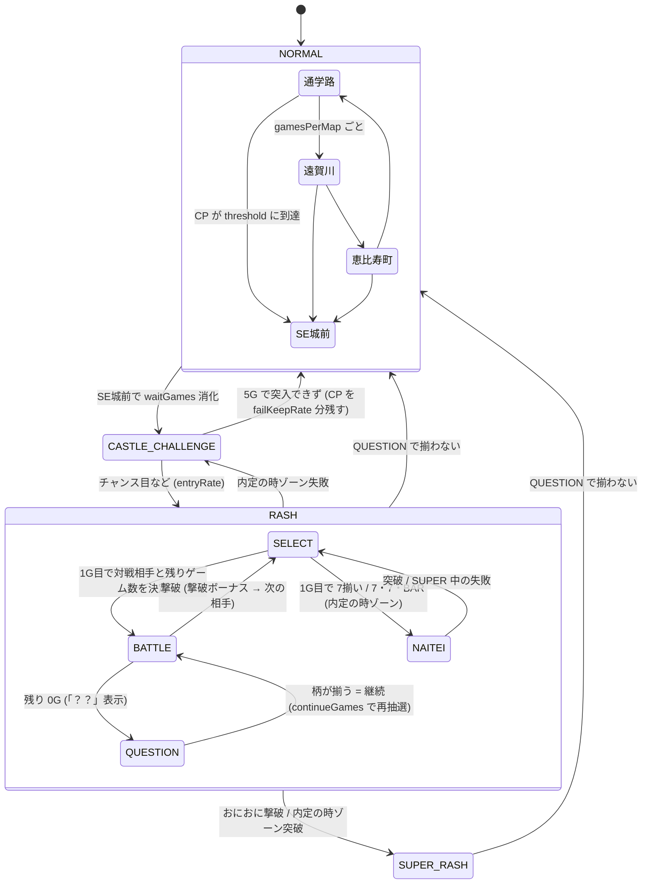

# CRこおりくんの大冒険 ～おにおにの野望～

主人公「こおりくん」が、ラスボス「おにおに」を倒すために SE城 を目指すスロットゲーム。
`slot/` の原型をもとに、液晶演出とゲーム性に特化して作り直している。

## 遊び方

- `index.html` をブラウザで直接開く（サーバー不要）
- レバー: **Space** / STOP: **J / K / L**（⚙ SETTINGS で変更可）
- `js/config.js` の `debug: true` で、画面下にデバッグパネル（状態の表示・強制遷移ボタン）が出る

## 筐体（2026-10-23 ユーザー指定：新しい台に。ASO の台と差別化）

- テーマは おにおにの「SE城」（`css/cabinet.css`。HTML は `index.html` の `.slot-machine.cabinet`）
- 上：瓦屋根の天守閣（反りのある 2 段の屋根・てっぺんの氷の宝珠・両はしに鬼の角）と、朱塗りに金ぶちの額のロゴ「こおりくんの大冒険 ～おにおにの野望～」
- 左右：朱塗りの柱と提灯の LED（上から順に流れて光る）。台の状態で色が変わる（通常 水色・城突入 朱・RASH 赤・SUPER 金・ロングフリーズ 虹）。筐体の外の光も同じ色
- 液晶：城門の形（上が丸い）の金の額縁
- リール：金のふちの窓。左右に 5 ラインの番号ランプ（1 上段・2 中段・3 下段・4 右下がり・5 右上がり。ラインの始まりの段に置く）。当たったラインの番号が金色に点滅する（`main.js` の `lightLine`）。STOP は金のふちの丸いボタン（押せるときは朱色。リーチ・押せ!! の色はそのまま）
- CREDIT・PAYOUT：7 セグふうの赤い数字。CREDIT は持っているコイン、PAYOUT はそのゲームの払い出し（`setPayout`）。まんなかに「3 BET」のランプ
- 下：石垣の台座と、鬼の金棒のレバー（黒い鉄の棒に金のいぼ。押すと倒れる）。城突入・リベンジ・？？ のときのレバーの色はそのまま
- スマホでは屋根を低く、柱を細く、STOP とレバーは指で押しやすい大きさのまま

## 演出の光（2026-10-23 ユーザー指定：当たったら周りのライトが虹色。演出に合わせて光り方を変えて盛り上げる）

`js/lights.js` が `body[data-light]` に光り方を入れ、`css/cabinet.css` が提灯・筐体のふち・液晶の額縁の光を変える（液晶の演出 `Lcd.playEvents` と同じときに光る）。

| 光り方 | いつ |
|---|---|
| 虹色（はじめに虹色の光のすじが回る） | 当たり：城突入・RASH 突入・撃破・「？？」で継続・復活・お仲間の救出・内定の時の勝利・SUPER 突入・ゾーンの当たり・フリーズ・疑似ボーナス（BIG・REG・エピソードBIG。消化中もずっと虹色）・レバー ON の確定／虹カットイン |
| 色で速く流れる | BATTLE 開始・リベンジ（赤）、城突入チャレンジ（橙。成功のゲームは金）、宝物庫・ポイントチャンス・天井（金）、内定の時（濃い赤）、ダンシングステージ（桃）、モード・天国の示唆（水色）、カットイン（その色） |
| 白く点滅 | 大ダメージ・撃破役、「？？」 |
| 暗く | 外れ：チャレンジ失敗・RASH 終了・リベンジ終了・「？？」で負け |

強い光（虹色）のあいだは弱い光で上書きしない。決まった秒がたつと、ふだんの台のモードの光に戻る。

## 疑似ボーナス（削除）

- 2026-10-23 に A5 で足した撃破の報酬の疑似ボーナス（BIG・REG・エピソードBIG）と、エピソードBIG のストーリー（`js/episode.js`）は、ユーザー指定（2026-10-23「BIG とレギュラーは削除、エピソードもいらない」）で消した。おにおにの撃破の報酬は上乗せ特化ゾーン（下）。A5 で一緒に足したモード・ゾーン・天井は残している
- 筐体の「ボーナス中はずっと虹色」の光は、上乗せ特化ゾーン中（`body[data-phase="TOKKA"]`）に使っている

## モード・ゾーン・天井（2026-10-23 A5。最新のスロット koori-slot の仕様書から）

- 前回の RASH からのゲーム数（`gamesSinceHit`。データカウンターの「現在」）で見る（`GameFlow.modeGame`。数字は `config.modes`）。CP をためて SE城前へ行く今の流れはそのまま
- **モード**は RASH が終わったときに設定ごとの重みで抽選（画面には出さない）。A（ゾーン 300G・600G）・B（200G・500G）・C（100G・300G、天井 400G）・天国（100G 以内）
- **ゾーン**（30G）：入るときに当たりか決め、当たりならゾーンのどこかのゲームで SE城前へ直行（「SE城へ いそげ!!」）。当たる割合 A 25%・50% ／ B 35%・50% ／ C 40%・60% ／ 天国 100%。ゾーンのあいだは液晶のまわりに黒い靄（A4 の前兆の見た目）
- **天井**：777G（C は 400G）に着くと、ナイナイ（アルアルは 20%）のカットイン「天井到達!!」→「城突入 確定!!」→ SE城前へ。そのあとの城突入チャレンジは必ず突入する
- **示唆**：天国のときは RASH が終わったあと 25% でシーシャ・ナイテイ（ナイナイかアルアル）のカットイン（出たら天国確定）。それ以外は 30% で ふるカワが モードをほのめかす（「なんだか すぐ 来そうな 気がする！」など。`config.modes.hints`）
- 設定ごとのモードの重み：天国 設定1 5%・2 5%・3 5%・4 7%・5 11%・6 15%
- デバッグパネル：「天井の 1G 前へ」「天国 モードへ」

## 前兆と違和感演出（2026-10-23 A4。最新のスロット koori-slot の画面設計書 3-4・5-7 を参考に）

- `js/zencho.js`（数字は `config.zencho`。案）。state を読むだけで、抽選・バトルは変えない（UI 側の乱数）
- **前兆**は「もう決まっているが、あとで知らせる」場面に出す
  - ダンシングステージ：チャンスゾーンの当選（`dance.zone`）は最後のゲームで発表。残り 2〜4 ゲームのあいだ、ゲームごとに 当選していれば 55%・していなければ 5%（ガセ前兆）で前兆が始まる。途中で当選すれば、そのまま本物になる
  - RASH の BATTLE：そのセットで勝つか（`rash.setWillWin`）は「？？」で発表。残り 1〜3 ゲームのあいだ、勝ちなら 50%・負けなら 8% で前兆が始まる
  - 前兆が出たら当たる割合：ダンシングステージ 約61%（ふだん 約23%）・バトル 約77%（ふだん 約51%）（`tools/test.js` で測る）
  - 見た目：液晶のまわりに黒い靄（ダンシングステージは紫、バトルは赤黒）と、ゆらゆら動く影。「なにかが 近づいてくる…」「決着の 時が 近い…」のひとこと。筐体の提灯と光が紫（バトルは赤黒）になる。始まりに低い「ゴゴゴ」の音。場面が変わったら終わり、結果は今までの演出で知らせる
- **違和感演出**（ASO の 5-7）：液晶にノイズ（`noise`）・そのゲームの音が消える（`silent`。効果音と BGM）・リールが逆に回って始まる（`reverse`）・STOP が紫に光る（`button`）。本前兆のゲームで 20%・ガセ前兆で 4%・前兆なしで 0.08%。出たら本前兆の割合は 約77%

## レバーの演出（2026-10-24 ユーザー指定。パチンコの「レバーを引け！」から）

- 選び方は `js/lever.js`（`LeverFx`）、数字は `config.lever`（Claude が決めた案）。演出だけで、役・バトル・出玉は変えない（UI 側の乱数）。自動テストで割合を確かめる
- **レバーを叩け!!**（`LeverFx.tataki`・`js/push.js`）：結果の前の PUSH（`Hype.plan`）のかわりに「レバーを叩け!!」。PUSH では進まず、金棒のレバー（`#spin-button`・Space）を叩くと進む（そのあいだだけレバーが押せる。リセット・台移動はできない）。レバーが PUSH の色で光って点滅し、金棒が揺れる。通常時は熱さ 3 以上でだけ出る（出たら熱さ 4 以上が約 99%）。**RASH 中は熱さ 6（確定）だけ**なので、出たら確定。40% は はじめ PUSH で出て、PUSH を押すと（押さなくても 0.9 秒で）白く光って変わる（`tataki.change`）
- **レバブル**（`LeverFx.atLever` の `buru`）：レバー ON で金棒がぶるぶる震える（スマホは本体も振動）。熱いゲームほど出やすい（熱さ 0〜6 ごとの `buru.rates`）
- **遅れ**（`okure`）：レバー ON のあと、リールが 0.52 秒遅れて回り出す（低いドンという音）。チャンス目・BAR（`notice.classes` の hot）20%、7揃い・7・7・BAR・ロングフリーズ（premium）30%。それより下の役では出ない
- **逆回転**（`reverse`）：リールが 1.5 秒逆に回り、虹色の光が流れて、リールの上のランプが虹になる。7揃い・7・7・BAR・ロングフリーズの 25%。遅れとは同じゲームに出さない。違和感演出の逆回転（0.52 秒・前兆）とは別

- **連続予告「？」**（2026-10-24 ユーザー指定）: 前兆（`js/zencho.js`。`beforeGame` が前兆の何ゲーム目か `games` を返す）のあいだ、レバー ON のたびに液晶に「？」を 1 つずつ増やして出す（4 つまで。色は 白 → 青 → 赤 → 金。`lever.question`）。期待度は前兆と同じ
- **STOP の色**（2026-10-24 ユーザー指定。`LeverFx.stopTier`・`lever.stopTier`）: 第 3 停止の前に、残りの STOP とリールの上のランプが 青 ＜ 赤 ＜ 金 ＜ 虹 で光る。熱さ 0〜6 ごとの出る割合と色の重み。虹は熱さ 6（確定）だけ
- **長押しの STOP**（2026-10-24 ユーザー指定。`LeverFx.longStop`・`lever.longStop`）: 熱いゲーム（熱さ 3 以上）で、第 3 停止が「長押し!!」。STOP（リール・キーも）を押している間 0.9 秒でたまり（液晶のふちが光る ため の光 `Lcd.setCharge`、ボタンの下からゲージ）、「はなせ!!」で離すと止まる。途中で離すとやり直し。クリックだけでは止まらない
- **PUSH の長押し・連打**（2026-10-24 ユーザー指定: ため演出・連撃演出）: 長押しは「ためろ!!」と ため の光 → 「フルチャージ!!」、連打は押すたびに「〇連撃!」で液晶が揺れて光り、最後に「〇連撃フィニッシュ!!」（`js/push.js`）
- **図鑑「レバーの演出」**（2026-10-24 ユーザー指定）: 叩け!!（通常時・RASH 中・PUSH から変化）・レバブル・遅れ・逆回転・STOP の色・虹の STOP・長押しの STOP・長押し / 連打の PUSH・連続予告を見た回数（`Collection.seeLever`、`state.collection.lever`）。実績「叩け確定」「逆回転」「ためて止めろ」「レバー演出マスター」

## 期待度の演出（2026-10-23 A3。最新のスロット koori-slot の画面設計書 3-6 を参考に）

- ものさしは ふるカワの「そのゲームの熱さ」（`Furukawa.heat`。0〜6、6 は確定）。レバー ON で `Hype.plan`（`js/hype.js`）が出す演出をまとめて選ぶ。数字は `config.hype`（案）
- 演出だけで、役・バトル・出玉は変えない（UI 側の乱数。自動テスト・シミュレーターには入らない）
- **カットイン**（`Lcd.chanceCutIn`）：青 ＜ 緑 ＜ 赤 ＜ 金 ＜ 虹。出たら熱い（熱さ 4 以上）割合は 青 約10%・緑 約25%・赤 約50%・金 約80%・虹 100%（ASO の案と同じ。熱さ 0〜3 でもときどき出る ガセ で合わせた。`tools/test.js` で測る）。色ごとの顔ぶれ（`config.hype.cast`）：青・緑 こおりくん・やすさん・たむさん・だけさん・ふるカワ ／ 赤 こおりくん・だけさん・おにおに・ともいし ／ 金 こおりくん・おにおに・ともいし・ふるカワ ／ 虹 こおりくん「こおりいきていける！」（セリフは案）
- **セリフの色**：前からある ふるカワの吹き出しの色（白 ＜ 青 ＜ 緑 ＜ 紫 ＜ 赤 ＜ 金 ＜ 虹）をそのまま使う
- **PUSH ボタン**（`js/push.js`・`#push-button`・B キー。設定で変えられる）：全リールが止まり、チャンス目の演出のあと、結果の前に出る。色は 白 ＜ 青 ＜ 赤 ＜ 金 ＜ 虹（出たら熱い割合は 白 約19%・青 約75%・赤 約99%・金 と 虹 100%）。激熱は飛び出す。押し方は 1 回（65%）・長押し 0.9 秒（20%）・連打 6 回（15%）。まわりの輪がゲージ。押さなければ 8 秒で進む
- **先バレ音**（`Sound.sakibare`）：レバー ON で鳴る。熱いゲームほど鳴りやすい ／ **確定音**（`Sound.kakutei`）：熱さ 6 の 35%
- **金発光**（`body.cab-gold`）：筐体のふち・提灯が金色に光る（熱さ 4 で 2%・5 で 15%・6 で 40%。確定音のときも）
- **フラッシュ**：弱 = リールが白く光る ／ 強 = リールが何度も光り、液晶も光る

## リールの止まり方（2026-10-23 A2）

- **押した位置から引き込む**（取りこぼしなし・目押しなし）：役はレバー ON で決まり、STOP を押したときに見えている位置（回転のアニメーションの途中の値）から、すべるコマ数がいちばん少ない出目を、同じ種類（`outcome.key`）の出目の表（`ReelMap`）から選びなおす（`Lottery.retarget`）。止まったリールの位置はそのまま。リーチを見せたあとは、揃うラインを変えない（`keepLine`）
- 役は変わらないので、出玉率は変わらない（自動テストで、どこで押しても同じ種類の出目・ハズレは揃わない・チャンス目は 1 つを確かめる）
- すべるコマ数（ばらばらに押したとき）：4 コマ以内はハズレ 約99%・ベル 約94%・リプレイ 約87%・チェリー 約82%・ダイヤ 約81%・スイカ 約73%・チャンス目 約69%・7 約58%・BAR 約52%。7・BAR は 1 本に 2 つなので、遠いと長くすべる（いちばん長くて 20 コマ）
- 止まるまでの時間は 0.07 秒 ＋ 1 コマ 0.032 秒（いちばん長くて約 0.7 秒）。すべり終わったら、光らせるコマのある周に見た目を変えずにうつす
- **リールの上のランプ**（`Reels.setLamp`）：回っている間は白・リーチは赤・押せ!! は金・揃うと金・チャンス目はピンク・ロングフリーズは虹

## オープニング・エンディング・ともいし

- はじめて遊ぶとき（保存データがないとき）・リセットしたあと・台移動したあとに、液晶で短いストーリーを流す（`js/lcd/opening-view.js`、約15秒。ユーザー指定）
  - リセット・台移動のときは、読み込み直す前に `SaveData.requestOpening` で印（localStorage の `koori-opening`）を残し、起動時に `takeOpeningRequest` で読んで消す
  - 台移動の「○番台に移動!」・続きからの「CONTINUE!」は、オープニングが終わってから出す
  1. 遠賀川のほとりで、こおりくんは母・ともいしと平和に暮らしていた
  2. SE城の主・おにおにが現れる（ともいし「あら…？」）
  3. おにおにがともいしを抱えて去っていく（ともいし「キャー！」）
  4. タイトル「こおりくんの大冒険 〜おにおにの野望〜」
- 液晶を押すか、レバー（Space）でスキップ。デバッグパネルの「オープニング」でいつでも見られる
- ともいし: こおりくんのお母さん。パーマ頭の石に黄色いエプロン（`sprites.js` の `SPRITES.tomoishi`、叫ぶ口の2コマ）
- SUPERおにおにRASH に移行するとき、ロゴのあとにともいしのカットインが出る（`config.js` の `tomoishi.superLines`:「お金返しなさい！」「内定はまだなの？」「こおり、がんばって！」）
- エンディング（ユーザー指定。`js/lcd/ending-view.js`、約17秒）: SUPERおにおにRASH 中におにおにを撃破すると、撃破の演出のあとに流れる（SUPER 1回につき1回。`Battle.defeatEnemy` が `{ type: 'ending' }` を返す。`state.rash.endingShown`）。SUPER に到達した RASH の約6割で見られる
  1. 金の広間。倒れたおにおにの横で、ともいしが駆け寄ってくる（「こおり〜！」）「おにおにを倒し、ついに ともいしを 助け出した！」
  2. 感動の再会。ハートが舞う（「こおり…！ 会いたかったわ！」）
  3. …と思ったら、めちゃくちゃ怒られる（「それはそれとして、お金返しなさい！」「内定もまだなの!?」）。こおりくんは後ずさりして汗
  4. 通学路を逃げるこおりくんと、追いかけるともいし（「待ちなさ〜い！」）「こおりくんの冒険は まだまだ続く…！」→ THANK YOU FOR PLAYING
  - 液晶を押すか、レバー（Space）でスキップ。終わったら RASH はそのまま続く。デバッグパネルの「エンディング」でいつでも見られる
  - 図鑑の記録に「エンディング」の回数、実績「ともいし救出」
- オープニング・エンディングを流す仕組みは `js/lcd/story-view.js`（`StoryView`。物語ごとのファイルが `register` で登録し、`play(name)` で流す。ナレーション・吹き出し・効果音の部品もここ）

## ファイル構成

| ファイル | 役割 |
|---|---|
| `howto.html` | 遊び方ページ（操作・ゲームの流れ・役と確率・対戦相手・設定。数値は `config.js` から自動で表示） |
| `js/config.js` | **調整用の数値すべて**（設定・確率・CP・ポイントチャンス・HP・ダメージ・ボーナス・演出） |
| `js/sprites.js` | キャラクターのドット絵データ（1文字=1ドット）と描画関数 |
| `js/backgrounds.js` | マップ背景のドット絵（レイヤーごとに描いて横スクロール） |
| `js/audio.js` | 効果音 |
| `js/state.js` | 状態（モード・マップ・フラグ）と状態遷移、1ゲームごとの状態更新 |
| `js/lottery.js` | 抽選（役の決定・出目の生成・重み付き抽選） |
| `js/furukawa.js` | ふるカワ（そのゲームの熱さ・出現・吹き出しの色・セリフを決める。敵への返事・撃破のひとこと、図鑑に載せるセリフの一覧も） |
| `js/battle.js` | RASH / BATTLE（対戦相手・ダメージ・撃破ボーナス） |
| `js/reels.js` | リール制御 |
| `js/lights.js` | 筐体の演出の光（当たりは虹色。`body[data-light]`） |
| `js/lcd.js` | 液晶演出（canvas に描画。場面・キャラクターの動き・イベントごとの演出） |
| `js/lcd/kit.js` | 液晶の描画の部品（文字・枠・線・イージング・折り返し）。`Lcd.init` が canvas を渡す |
| `js/lcd/special-fx.js` | 必殺技のエフェクト（技ごとの描画と長さ） |
| `js/lcd/chance-fx.js` | チャンス目の演出（スイカ崩れ・BAR崩れ・7崩れの画面） |
| `js/lcd/trophy-view.js` | 設定示唆トロフィー（左下に落ちてくる） |
| `js/lcd/end-card-view.js` | RASH 終了画面（設定示唆の1枚絵。絵ごとの描き方） |
| `js/lcd/furukawa-view.js` | ふるカワ（右下の姿と吹き出し） |
| `js/lcd/story-view.js` | オープニング・エンディングを流す仕組み（スキップ・暗転・ナレーション・吹き出し） |
| `js/lcd/opening-view.js` | オープニング（はじめて遊ぶとき・リセット・台移動のあとに流す短いストーリー） |
| `js/lcd/ending-view.js` | エンディング（SUPER 中におにおにを撃破すると流れる） |
| `js/profiles.js` | **図鑑のキャラクター説明の文章**（ひとこと・説明。ここを書けば図鑑に出る） |
| `js/updates.js` | **アップデート情報の文章**（更新を公開するときに先頭に1件足す）と、開いたときに表示するかどうかの判定 |
| `js/layout.js` | パソコンでの表示モード（ふだんは画面に収まるよう拡大・縮小、「全画面」で筐体だけを全画面表示） |
| `js/ui.js` | ステータス表示・キーボード操作・設定画面・デバッグパネル |
| `js/save.js` | データの保存と読み込み |
| `js/bgm.js` | BGM（曲データと再生） |
| `js/main.js` | 起動と1ゲームの流れ |
| `tools/simulate.html` | 出玉シミュレーター（ブラウザ版。設定ごとの出玉率などを計測） |
| `tools/simulate.js` | 出玉シミュレーター（Node.js 版。並列で速く、セット継続率・複数回の平均・数値の一時変更にも対応） |
| `manifest.webmanifest` / `sw.js` / `icons/` | ホーム画面に追加（PWA）の設定・ネットなしで遊ぶためのキャッシュ・アイコン |
| `tools/make-icons.html` | ホーム画面のアイコンを作るページ（こおりくんのドット絵から描く） |
| `tools/bump-version.js` | HTML が読み込む js / css に版番号（`?v=`）を付け直す（コミットのたびに自動） |
| `.githooks/pre-commit` | コミットの前に `tools/bump-version.js` を動かす |
| `tools/test.js` | 自動テスト（Node.js。ロジックを自動プレイして、履歴・トロフィー・ブレイク・勝利確定・必殺技・設定推測・図鑑・台移動・保存データ・出玉シミュレーターが動くかを確認） |

`config.js` が `.json` ではなく `.js` なのは、`index.html` を直接開いたときにブラウザの制限で `.json` を読み込めないため。中身はデータのみ。

## 1ゲームの流れ

```
レバーON → コイン投入 → Lottery.draw (役と出目を決定)
→ Reels.spin (STOPで停止) → 払い出し
→ GameFlow.onGameEnd (状態を更新し events を返す)
→ Lcd / UI が events と state を見て演出・表示
```

状態を書き換えるのは `state.js` と `battle.js` だけ。演出側は state を読むだけにしている。

## 状態遷移



- `SUPER_RASH` の中の流れは `RASH` と同じ（継続率 93%、対戦相手にゴールド金面犬が追加）
- 継続率は **セットの開始時に先に決める**（`rash.setWillWin`）。負けセットでは撃破しない範囲にダメージを抑え、「？？」で揃わない出目にする

### 管理している状態

| 項目 | 場所 |
|---|---|
| モード（NORMAL / CASTLE_CHALLENGE / RASH / SUPER_RASH） | `state.mode` |
| マップ・ループ位置・マップ内ゲーム数 | `state.normal.map` / `loopIndex` / `gamesInMap` |
| チャンスポイント | `state.normal.chancePoint` |
| SE城前の待機ゲーム数 | `state.normal.castleWaitRemaining` |
| 城突入チャレンジの残りゲーム数 | `state.challenge.gamesRemaining` |
| RASH のフェーズ（SELECT / BATTLE / QUESTION） | `state.rash.phase` |
| 対戦相手・HP・残りゲーム数 | `state.rash.enemyId` / `enemyHp` / `gamesRemaining` |
| 撃破回数（1回の RASH 内） | `state.rash.defeatCount` |
| おにおに出現フラグ | `state.rash.oniUnlocked` |
| 連数 | `state.rash.streak` |
| 特化ゾーンで前に選んだ見せ方 | `state.tokkaLastKind` |
| 上乗せ特化ゾーンの途中 | `state.rash.tokka` / `tokkaReturnPhase` |
| ゴールド金面犬フラグ・次の相手確定 | `state.rash.goldDogFlag` / `nextForcedEnemy` |
| 柄揃い確率アップ | `state.rash.probUpGames` / `probUpMultiplier` |

## 設定ファイルの項目（`js/config.js`）

| 項目 | 内容 |
|---|---|
| `coins` | 1ゲームのコイン数、開始コイン、購入金額・枚数 |
| `reels` | 図柄の並び、払い出し枚数、チャンス目の出目 |
| `lottery.normal / castleChallenge / battle` | 状態ごとの役の確率 |
| `chancePoint` | 1ゲームごとの加算、チャンス目・柄揃いの追加加算、SE城前への規定値 |
| `map` | ループ順、マップ名、1マップの滞在ゲーム数 |
| `castle` | SE城前の待機ゲーム数、チャレンジのゲーム数、出目ごとの突入率、失敗時に残す CP の割合 |
| `rash` | 継続率（通常 / SUPER）、初期・継続時のゲーム数テーブル、おにおに出現に必要な撃破数 |
| `damage` | 柄ごとのダメージ（7 は確定撃破） |
| `enemies` | 敵ごとの出現の重み（通常 / SUPER）、HP、撃破ボーナス |
| `goldDog` | ゴールド金面犬の出現確率・HP・ボーナス・撃破後の確定相手 |
| `effects` | 液晶の解像度、演出の時間、画面揺れの強さ、カットイン率 |
| `keys` | キー割り当ての初期値 |

## マップ背景（ドット絵）

| マップ | 内容 |
|---|---|
| 通学路 | 朝の住宅街。家・学校・電柱と電線・歩道・横断歩道 |
| 遠賀川 | 山並み・赤い鉄橋・川・土手の道と草花 |
| 恵比寿町 | 夕焼けの商店街。看板・のれん・店先の品物・提灯・石畳 |
| SE城前 | 夜。月と星・赤く光る城（家紋「SE」）・石垣・たいまつ（炎が揺れる） |

通常時はこおりくんが歩き、背景は奥ほどゆっくりスクロールする（SE城前では立ち止まる）。
マップ切り替えは左右からのワイプ＋マップ名表示、SE城前への移動は赤いフラッシュ＋上下の黒帯＋「SE城が見えてきた！」。

## 城突入チャレンジ

- SE城前で `castle.waitGames` を消化すると開始。`castle.challengeGames`（5G）の間、出目ごとの突入率 `castle.entryRate` で毎ゲーム判定し、当たったゲームで即突入
- 現在の数値での突入成功率は **約41%**（2万回のシミュレーション）。主にチャンス目（チャレンジ中 1/15、突入率100%）で突入する
- 成功: こおりくんのカットイン「こおりばりきつよい！」（帯の上に「突入成功!!」、`castle.entryCutIn`。ユーザー指定）→ 門が開く → こおりくんが城へ → RASH へ（CP は 0 に戻る）。7・7・BAR での突入も同じ
- 失敗: 「突入失敗…」→ CP を `castle.failKeepRate`（50%）残して通常時のマップへ
- 7・7・BAR: チャレンジ中 `lottery.castleChallenge.sevenBar`（1/500）で揃うと必ず突入し、最初の相手はおにおに（「7・7・BAR!! 突入!! 最初の相手は おにおに!!」）。1/150 では SUPER が出すぎて出玉率が 7〜9% 上がったため 1/500 に
- 演出: 開始時に赤フラッシュ・画面揺れ・上下の黒帯＋「城突入チャレンジ!!」、こおりくんが門の前へ。外れたゲームは門に体当たりして「はじかれた！」。残りゲーム数は5つのランプで表示し、チャレンジ中はレバーが赤く光る
- SE城前の待機中（`castle.waitGames` の3G）にチャンス目を引くと、そのあとの城突入チャレンジの突入率が `castle.chanceBoost`（×1.5）に（ユーザー指定）。仲間の倍率とも掛け合わせる（`GameFlow.castleEntryBoost`）。1回だけで重ねがけはしない
- 仲間・オーラの倍率が `castle.minBoost`（×1.3）より小さいときは ×1.3 にする（ユーザー指定: 仲間なし・オーラなしの成功率を少し上げる。設定1で約28% → 約31%）。やすさんだけ（×1.15）も ×1.3 になり、それ以上の組み合わせは変わらない。設定推測の記録もこの倍率ごと（以前の保存データの ×1 の記録は ×1 のまま計算する）
  - 演出: 赤フラッシュ・揺れ・「突入率UP!!」「こおりくんが燃えている！」。突入率UP中は、こおりくんが赤いオーラ（脈打つ赤い光と足元から立ちのぼる炎）をまとう。チャレンジ開始の帯には仲間とオーラを合わせた倍率（例: 突入率×1.73）
  - チャレンジが終わると（成功・失敗）、SE城前に入り直すと、ロングフリーズなどで RASH に入ると、突入率UPは終わる（`state.challenge.chanceBoost`）
  - 突入成功率は設定ごとに約0.5ポイント上がり、出玉率は +0.1〜0.8%（設定ごと3000万ゲーム）。設定3 まで 100% 未満のままなので再調整なし

## おにおにRASH / BATTLE

- RASH の1ゲーム目（撃破後の次のゲームも）で、対戦相手（`enemies` の重み）と残りゲーム数（`rash.initialGames`）を決定
- BATTLE 中は柄ごとにダメージ（`damage`）。チャンス目は大ダメージ、7揃いは確定撃破、ベルはダメージなし
- 残り 0G で「？？」。柄が揃えば同じ相手・HP のまま継続（`rash.continueGames`）、揃わなければ敵の必殺技をくらって RASH 終了（下の「必殺技」）
- 継続率はセット開始時に先に決める（`setWillWin`、確率は `presetRate`）。負けセットではダメージは HP が 1 残るまで（「ガード!」表示）、「？？」では揃わない
- シミュレーション（5000回）: セット継続率 69.9%、1回の RASH で平均 2.3 体と対戦・31 ゲーム、RASH 中のコイン収支は 1ゲームあたり +1.8 枚
- 演出: 突入時に赤い「おにおにRASH」ロゴ（SUPER は金色）と「RASH突入!!」、RASH 中は左上にロゴを常時表示。対戦相手ルーレット → 敵が登場し「VS ○○」。攻撃はこおりくんの体当たり＋白く光る・画面揺れ・ダメージの数字・HP バーが減る。大ダメージは白フラッシュと大きな揺れ、7揃いは「一撃必殺!!」。撃破は金フラッシュで敵が消える。「？？」は点滅表示

## ガード崩し・ブレイク

- 負けセットでは敵がガードし、ダメージは HP が 1 残るまで（「ガード!」表示）
- `damage` が `'kill'` の役（BAR揃い・7️⃣7️⃣7️⃣・7️⃣7️⃣BAR）はガードを崩して確定撃破（「ガードブレイク!!」）。7️⃣7️⃣BAR は BATTLE 中の役（`lottery.battle.sevenBar`、出目は `reels.specialPatterns`）
- とどめの一撃（2026-10-19 ユーザー指定）: ガードを崩せない役の攻撃がガードされたとき、`finalBlow.rates` の確率（リプレイ 1%・ダイヤ 2%・スイカ 3%）で「とどめの一撃!」のカットイン → ガード無視の 1 ダメージで撃破（ダメージのイベントの `finalBlow`。とどめはこおりくん、仲間の追撃はなし、図鑑の必殺技には数えない）。チェリー・チャンス目は自分でブレイクできるので対象外。追加で出玉率は 約+0.6〜1.3%（設定ごと1000万ゲーム。`presetRate` はそのまま）
  - 図鑑: 記録「とどめの一撃」（回数）、実績「ガード無視!!」（1回決める）。ふるカワは撃破のひとことの代わりに `furukawa.finalBlowLines`（「ガードなんて関係ないね！」など）
  - デバッグパネルの「次:とどめの一撃」で確認できる（次の BATTLE でリプレイ・ダイヤ・スイカが出たら、HP やセットに関係なくガード → とどめの一撃。RASH 中でなければ RASH へ移る。`DebugState.forceFinalBlow`）
- BATTLE 中に `breakState.rates` の役が出ると、その確率でブレイク状態（チェリー揃い 25%・チャンス目 50%）。その役の攻撃からガードできなくなり、今の敵を倒すか RASH が終わるまで続く（紫の「BREAK!!」、HP 枠に「BREAK」表示）。チャンス目は大ダメージ（60）なので、ブレイクするとそのまま倒しきれることが多い
- ガード崩し・ブレイク・仲間の肩代わり・復活で続く分を見込み、セット開始時の先決めの確率 `presetRate` を目標の継続率 `continueRate` より低くしている（通常 0.380 / SUPER 0.848。リベンジの引き継ぎ追加前は 0.390 / 0.853、復活演出の追加前は 0.470 / 0.875、チャンス目のブレイク追加前は 0.550 / 0.896）
- 復活演出の追加後（設定ごと3000万ゲーム）: セット継続率（撃破・「？？」の結果で数え、肩代わり・復活は負けとして数えた値）は 通常 約63.4% / SUPER 約91.7%。復活（通常 10% / SUPER 15%）を含めると 約67% / 約93%、さらに仲間の肩代わりで通常は約70%になる
- シミュレーション（設定ごと1000万ゲーム）: セット継続率は 通常 RASH 約68.3%、SUPER 約92.8%（撃破・「？？」の結果で数え、仲間の肩代わりは負けとして数えた値。チャンス目のブレイク追加前と同じ水準）。`presetRate` を 0.550 / 0.896 のままにすると 73.2% / 94.0% に上がり、出玉率は約+11〜16%
- ダメージ・確率・ブレイク率を変えたときは、シミュレーションで `presetRate` を合わせ直す

## 撃破ボーナス・おにおに・SUPER・ゴールド金面犬

- 撃破ボーナス（`enemies[].bonus`）: `coins` はその場で加算、`games` は次の BATTLE のゲーム数に上乗せ、`probUp` は指定ゲーム数の間リプレイ以外の揃い役の確率を `value` 倍
- おにおに（2026-10-23 ユーザー指定で連数に変更）: 1回の RASH で `rash.oni.unlockStreak`（3）連すると「おにおにが現れる…!?」→ 以降、重み付き抽選の候補に入る。SUPER 中は最初から候補に入っているので「おにおにが現れる…!?」は出ない（`Battle.checkOniUnlock`）
  - 連 = セットを勝った回数（撃破・「？？」の継続・仲間の肩代わり・復活・内定の時ゾーン突破で1連ずつ。`Battle.addStreak`）。液晶の左上のロゴの横に「〇連」と出す（10連から赤）。リベンジチャンスでは撃破数と一緒に引き継ぐ
  - 連するほど出やすい（ユーザー指定）: 対戦相手を決めるとき、おにおにだけ先に `Battle.oniRate` の確率で抽選し、外れたらほかの敵を重みで選ぶ。候補に入った 3連では重みどおりの約13%、そこから `maxStreak`（10）連までまっすぐ上げて `maxRate`（50%）、それ以降はずっと 50%。SUPER 中は連数で変わらない（ユーザー指定。重みどおりの約14%）
- おにおに撃破で SUPERおにおにRASH へ（継続率 93%、背景とロゴが金色、`superStart` 演出）。SUPER 中はおにおにが常に候補（`rash.superOniAlwaysAvailable`）
- ゴールド金面犬: SUPER 中の対戦相手抽選ごとに `goldDog.prob`（1/100）。撃破で 2000 枚、次の相手はおにおに確定
- シミュレーション: SUPER のセット継続率 93.07%（3000回）、金面犬の出現 1/99、金面犬撃破後の次の相手は 10/10 でおにおに、撃破3体前のおにおに出現 0回
- Mr.SASAKI はユーザー指定で「黒人のイケイケな社員」（ハイトップフェード・ロイヤルブルーのスーツ・社員証・金の腕時計・指さしポーズ）

## リールと当たりライン

- 各リールに上段・中段・下段の3つの図柄が見える（3×3）。当たりは5ライン（上段・中段・下段・右下がり・右上がり）
- リール配列は左・中・右で別々（`reels.strips`、各21コマ）。同じ並びだと複数の段が同時に揃うため
- 役の抽選（確率）はこれまでどおり。当たった役に合う止まり位置を、起動時に全組み合わせ（21×21×21 = 9261通り）を分類した表から選ぶ（`ReelMap`、約30ms）
  - 揃い役: ちょうど1ラインだけ揃い、チャンス目にならない出目
  - チャンス目: どのラインも揃わず、指定のチャンス目が1つだけ出る出目
  - ハズレ: どのラインも揃わず、チャンス目にもならない出目（`effects.fakeReachRate` の確率で 7・BAR のリーチ目を含む出目を選ぶ = ガセリーチ）
- チャンス目（`reels.chancePatterns`）: スイカ崩れ・BAR崩れ・7崩れ（5ラインのどこでも）。`weight` で出やすさを指定
- 左リール中段チェリーはロングフリーズ専用のため、チェリーは中段では揃わない（上段・下段・斜めで揃う）
- リーチは2本止めた時点で判定。揃うラインのリーチと、`effects.reachSymbols`（7・BAR・スイカ）のリーチで演出が出る。液晶にリーチのライン名を表示
- 揃ったラインの図柄は金色、チャンス目の図柄はピンクに光る
- リール配列やチャンス目を変えたときは、起動時の確認（`Lottery.validate`）で「出目が用意できない役」があればエラーを表示する

## リベンジチャンス

- RASH / SUPER が終わって通常時に戻ったあと、`revenge.games`（3G）の間にチャンス目を引くと、おにおにRASH に再突入
- 5G でも試したが出玉率が上がりすぎたため 3G に（再突入率は約7〜8%）。この間はポイントチャンス・お仲間チャレンジは起きない。ロングフリーズは通常どおり
- 演出: 「リベンジチャンス!!」→ 画面の赤い縁取りと右上の残りゲームのランプ、レバーが赤く光る → 成功で「リベンジ成功!! おにおにRASH 再突入!!」/ 3G で引けなければ「リベンジ失敗…」
- 成功すると、終わった RASH の撃破数（おにおにの出現フラグも）を引き継ぎ、SUPER だったときは SUPERおにおにRASH に戻る（ユーザー指定）。RASH 終了時に `state.normal.revengeCarry` に覚えておき、リベンジ失敗・ほかの契機の RASH 突入で消す。成功時は「SUPERおにおにRASH 復帰!!」、撃破数があれば「撃破数を引き継ぎ ○体から再スタート!!」
- 獲得枚数は引き継がない（大当たり履歴は新しい1回として記録し、撃破数は引き継いだ分を含む）

## チャンス目の演出

- チャンス目が止まると、種類ごとの演出が流れる（`effects.chanceEffects`）
  - スイカ崩れ: 大きなスイカが跳ねて赤と緑の果汁が飛び散る
  - BAR崩れ: 白黒の点滅の中、BAR の板が上から3枚落ちてくる（画面揺れ）
  - 7崩れ: 回る赤と金の光の筋と脈打つ大きな7、「激アツ!!」

## 必殺技

- 名前は `config.js` の `specials`（こおりくん・「？？」の表示）、`enemies[].special` / `goldDog.special` / `naitei.enemy.special`（敵）、`companions.members[].special`（仲間）

| キャラ | 必殺技 | 出るとき |
|---|---|---|
| こおりくん | 大腸炎アタック | とどめを刺したとき |
| こおりくん | ばりきつよめのレクイエム | 内定の時ゾーンを突破したとき（ユーザー指定） |
| こおりくん | 7つの内定フラッシュ | 一撃必殺の役（BAR揃い・7揃い・7・7・BAR）でとどめ |
| やすさん / たむさん / だけさん | やすパンチ / たむキック / だけチョップ | 仲間の追撃でとどめを刺したとき |
| おかがっぱ | おかピポっと光線 | 「？？」で継続できなかったとき |
| ひびきまくり | 大音響4DX | 〃 |
| シバター | シバタードライバー | 〃 |
| Mr.SASAKI | ASAスラッシュ | 〃 |
| おにおに | 鬼鬼の金棒 | 〃 |
| ゴールド金面犬 | ゴールドかみまっくす | 〃 |
| シーシャ・ナイテイ・ナイナイ | 不採用の裁き | 内定の時ゾーンを突破できなかったとき |

### 敵のセリフ（ユーザー指定）

- 敵の顔の左に吹き出しで `effects.timing.enemyTalk`（1.1秒）しゃべる。出てきたとき（`intro`。「VS ○○」の前。おにおに・金面犬はカットインのあと）と、必殺技のカットインの前（`special`）。文章は `config.js` の `enemies[].lines` / `goldDog.lines` / `naitei.enemy.lines`（ないものは言わない）

| 敵 | 出てきたとき | 必殺技の前 |
|---|---|---|
| おかがっぱ | ま～だまだ戦わねば！ | おかピポ！イェア！ |
| ひびきまくり | 響きです。 | これが４DXだ！ |
| シバター | ぶんぶん！ | バーイ！ |
| Mr.SASAKI | どうも、しご出来です。 | 締め切り厳守です。 |
| おにおに | - | 金返せ！ |
| ゴールド金面犬 | ワン！（自信ありげ） | ワン！（邪悪な笑み） |
| シーシャ・ナイテイ・ナイナイ | - | お前に内定はない！ |

- とどめを刺したのが誰かは BATTLE のダメージのイベントに入る（`finishBy`: `'koori'` か仲間の id、`finishKill`: 一撃必殺）。こおりくん → 仲間の順に攻撃し、こおりくんの分で倒しきれたらこおりくん、仲間の追撃で倒したら最後に当てた仲間（`Battle.finisherOf`）
- こおりくんの必殺技はとどめの攻撃の前に、仲間の必殺技はその仲間が追撃する直前にカットイン（帯の上に「○○の必殺技!!」、技名は帯の幅に合わせて縮める）。ロングフリーズの完全撃破は従来どおり「完全撃破!!」
- 「？？」の間は液晶の下に「敵がこうげきしそうだ…！」が点滅し、敵の後ろで赤いオーラが脈打つ
- 「？？」で揃わなかったとき: 敵のカットイン（必殺技）→ 技ごとのエフェクトがこおりくんに当たる（赤フラッシュ・大きな揺れ・こおりくんが点滅してはじかれる）→「RASH終了…」。仲間が肩代わりするときは、敵の必殺技のあと仲間がかばう（こおりくんには当たらない）
- 技ごとのエフェクトと効果音（`lcd.js` の `SPECIAL_FX` / `FX_DRAW`、`audio.js` の `Sound.special`）:

| 必殺技 | エフェクト |
|---|---|
| おかピポっと光線 | 口から緑の光線がのびて、こおりくんに当たる |
| 大音響4DX | 音の輪が何重にも広がり、音符が飛ぶ |
| シバタードライバー | 跳び上がってこおりくんの目の前に叩きつけ、地面から衝撃波と破片 |
| ASAスラッシュ | 青白い斬撃が3本、斜めに走る |
| 鬼鬼の金棒 | 巨大な金棒が上から振り下ろされる |
| ゴールドかみまっくす | 金色の牙が上下から噛みつき、金貨が飛び散る（フラッシュも金色） |
| 不採用の裁き | 赤い「不採用」のハンコが押される |
| 大腸炎アタック | 敵に当たった瞬間、氷のかけらが飛び散る |
| 7つの内定フラッシュ | 虹色の光の柱が7本、順に敵を撃ち抜く |
| ばりきつよめのレクイエム | 敵の上に金色の十字の光がそびえ、音符が舞い上がる（フラッシュも金色） |
| やすパンチ / たむキック / だけチョップ | 大きな拳が飛んで星がはじける / 弧を描く蹴りの軌跡 / 上から一直線の手刀の光 |

- 敵の必殺技が当たった瞬間のフラッシュは、エフェクトが透けて見えるよう薄め（60%）
- 内定の時ゾーンの失敗: 「不採用の裁き」のあと「突破失敗…」

## 復活演出

- 「？？」で揃わず、仲間の肩代わりもなかったとき、`revival.rates`（おにおにRASH 10% / SUPER 15%）で復活が決まる（ユーザー指定。`Battle.questionGame`）
- 復活が決まったら RASH を終わらせず、復活待ち（`RASH_PHASES.REVIVAL`）にする。液晶は敵の必殺技 →「RASH終了…」までふつうの敗北と同じで、そのあと通常ステージに戻らず、RASH の場面が暗いまま止まる。モード表示は「通常時」、BGM は敗北の曲のまま（負けたように見せる）
- 次のレバー ON で画面が暗転し、BGM も止まる（`Lcd.revivalBlackout`）。このゲームのリールは 7揃い確定（ユーザー指定。`Lottery.draw`。演出なので払い出しはなし: `outcome.noPayout`）。リールが止まると、暗闇の中でこおりくんだけが光り輝いて（金色の光と回る光線）3回フラッシュ →「こおりまだまえる！」（`revival.text`）でバトルの BGM が戻る → 戦っていた敵に一撃で撃破（`Battle.revivalGame`。出目に関係なく、撃破ボーナス・おにおに出現・SUPER 移行もふつうの撃破と同じ）
- 図鑑の記録に「復活」の回数、実績「こおりまだまえる」（復活して敵を撃破する）
- デバッグパネルの「次の？？で復活」で確認できる（RASH の「？？」にして、次のゲームで必ず負けて復活待ちに。もう一度レバー ON で復活演出。RASH 中でなければ RASH へ移り、相手がいなければおかがっぱ。`DebugState.toRevival`）

## 負けたときのダウン

- 「？？」で負けたとき・内定の時ゾーンの失敗のとき、敵の必殺技のあと、こおりくんの目が × になって後ろに倒れ（`SPRITES.koori` の `down`）、仲間も少しずつ遅れて倒れる。頭の上を星がくるくる回る（ユーザー指定）
- 倒れたままの姿は、通常ステージに戻るまで（SUPER が続くときは「SUPER継続!!」まで、復活のときはこおりくんが光り輝くまで）
- 出玉率が約+8〜13%上がったため、RASH の `presetRate` を 通常 0.470→0.390 / SUPER 0.875→0.853 に下げて元の水準に戻した

## バトル敗北の BGM

- 「？？」で負けたとき・内定の時ゾーンの失敗のとき、そのゲームの演出のあいだ敗北の曲（`bgm.js` の `defeat`。72bpm のゆっくり下がっていく短調）を流す。演出が終わると通常時などの曲に戻る
- 復活待ちのあいだも敗北の曲が流れ続ける

## 宝物庫ゾーン

- RASH / SUPER の BATTLE 中、1ゲームごとに `treasure.rate`（1/100）で突入するゲーム数上乗せ特化ゾーン。「？？」になったゲームでは突入しない（撃破直後は突入する）
- `treasure.games`（5G）の間 BATTLE を中断（残りゲーム数は減らない）。専用の確率表 `treasure.lottery` で抽選し、揃った柄・チャンス目に応じて `gamesByRole` のゲーム数を次の BATTLE に上乗せ（リプレイ+1・ベル+2・チェリー/ダイヤ+3・スイカ+5・BAR/7・7・BAR+10・チャンス目+15・7+20）
- ゾーン中にロングフリーズが当たると、戦闘中の敵を完全撃破 → 次の BATTLE +`freezeBonusGames`（50G）、SUPER 突入（SUPER 中ならそのまま）、次の相手はゴールド金面犬
- 終わると元の BATTLE（撃破直後なら次の相手の決定）に戻る。上乗せは「次のBATTLE +NG」と表示され、次の BATTLE 開始時に加算
- 演出: 金貨の山と宝箱の宝物庫（ドット絵）。揃うと宝箱が開いてコインが飛び出し「+NG」、残りゲームはランプで表示
- シミュレーション: BATTLE 中の約1/90で突入、1回あたり平均約12G上乗せ（調整前の確率表での値）

## 熱いときに震える枠（2026-10-24 ユーザー指定: 映像の中の外枠が震える）

- レバー ON で決まったそのゲームの熱さ（`Furukawa.heat`。0〜6）が `config.hotFrame` の値以上なら、液晶のふちに太い枠を出してぶるぶる震わせる（赤 4 / 金 5 / 虹 6 = 確定）。ゲームの結果の演出が終わると消す（`Lcd.setHotFrame`・`drawHotFrame`。毎フレーム いちばん上に描く）

## プレミア: 液晶のひび割れ（2026-10-24 ユーザー指定。パチンコの 1・3・5 のひび割れと同じ流れ）

- 確定（熱さ 6）のゲームの 15%（`config.premiumCrack.rate`）で、リールが回る前に流す（約 4.8 秒。`Lcd.playCrack`）。暗くなる → 液晶がまっぷたつにひび割れ → 割れた左右がずれ、赤いすき間からおにおにがせり上がる → 画面が粉々に砕けて飛ぶ → 赤い画面で咆哮「グオオオオオ!!」→「確定!!」。音は `Sound.premiumCrack` / `premiumSmash` / `premiumRoar` と確定音。図鑑の「レバーの演出」に「液晶の ひび割れ (プレミア)」（「全種類」には数えない）、実績「ひび割れ」

## 通常時の予告・こおりチャンスタイム（2026-10-23 ユーザー指定: 通常時が長くなったので演出を増やす）

- キャラとセリフはパチンコ（koori-pachinko）・新作のスロット（koori-slot-aso）を参考にした
- **予告**（`js/notice.js` の `Notice.pick`・`config.notice`）: レバー ON で、そのゲームの役で選ぶ。演出だけで、出目や抽選は変えない。通常時のマップ・SE城前だけ（ダンシングステージ・リベンジチャンス・RASH 中は出さない）
  - 役の分類: premium（7揃い・7・7・BAR）/ hot（チャンス目・BAR）/ warm（スイカ・チェリー）/ cold（ほか）。予告が出る率は 90% / 55% / 25% / 3%
  - **カットイン**: 青・緑・赤・金・虹。色ごとのキャラとセリフは新作と同じ顔ぶれ（ふるカワも出る）。**虹「こおりいきていける！」は7揃い・7・7・BAR 確定**
  - **ステップアップ予告**: 1〜3段。キャラの組は5つ（こおりくん・ふるカワ・ともいし・お仲間・おにおに。パチンコと同じ。ともいしのセリフは前作に合わせた）。3段目の文字が赤ならチャンス、金なら激アツ
  - **群予告**: こおり群・おにおに群・ひびきまくり群。**ひびきまくり群はチャンス目・BAR 以上確定**（パチンコと同じく確定の群）
  - 描くのは `js/lcd/notice-view.js`（ステップアップ・群）と lcd.js のカットイン（`Lcd.playNotice`）。リールが回っている間に流す
- **こおりチャンスタイム**（`config.chanceTime`）: 通常時のマップでチャンス目 25%・BAR 20%・スイカ 6%・チェリー 2% で突入（次のゲームから）。10G のあいだチャンスポイントの加算（1ゲームごと・チャンス目・柄揃い）が2倍
  - 演出: ふるカワのカットイン（「こおりくん、チャンスだよ！」「今だよ、こおりくん！」など 5 種類から 1 つ。`chanceTime.startLines`）→「こおりチャンスタイム!!」。上に「CHANCE TIME 残りNG ポイント×2」の帯ときらきら、ふるカワが「がんばって！」「いけいけ〜！」など（7 種類が順に入れかわる。`chanceTime.cheerLines`）と応援しながら こおりくんの後ろを付いてくる（2026-10-24 ユーザー指定で ともいし → ふるカワ）。終わると「チャンスタイムで +N CP」
  - SE城前に着くと終わる。チャンスタイム中はダンシングステージに入らない。リベンジチャンス中は入らない
- 7揃いのチャンスポイント（`chancePoint.onAligned.seven`）を規定値 150 に合わせた（100 のままだと 7揃いで SE城前へ直行しなくなっていた）
- デバッグパネル: 「次:チャンスタイム」「次の予告:カットイン / ステップアップ / 群」（種類だけ指定。色や段は役で決まる）

## 上乗せ特化ゾーン（2026-10-23 ユーザー指定）

- おにおにの撃破の報酬（撃破ボーナスの枚数の代わり）。ほかの撃破でも `tokka.trigger` の確率で突入する（シーシャ・ナイテイ・ナイナイ（アルアルも）確定（ユーザー指定）・ゴールド金面犬 10%・ほかの敵 2%。ゴールド金面犬・ナイナイの撃破ボーナスはそのまま）
- `tokka.games`（10G）の間 BATTLE を中断。専用の確率表 `tokka.lottery` で抽選し、1ゲームごとに役に応じて `addTable` の枚数を上乗せ（ハズレ 5〜30枚 … 7揃い・7・7・BAR は 300〜1000枚）。合計は `max`（1000枚）まで
- 終わったら合計をまとめて払い出す。合計が `min`（300枚）より少なければ 300枚（300枚保障）。上限 `max` は 1000枚（ユーザー指定）
- 見せ方は4つ。**突入したらプレイヤーが選ぶ**（ユーザー指定: 新作と同じ）。上乗せの確率はどれも同じ
  - 選ぶ画面: 突入の告知のあと、4枚のカード。左の STOP・右の STOP で選び、レバーかまんなかの STOP で決定。液晶のカードのタップでも選べる（選んでいるカードをもう一度タップで決定）。前に選んだもの（`state.tokkaLastKind`）を最初に選んでおき、`selectMs`（10秒）たったらそれで始める
  - 選ぶ間は main.js がレバーと STOP を押せるようにし、押されたら `Lcd.tokkaSelectInput` に回す（キーボードは ui.js）。選んだ見せ方は `Battle.chooseTokka` で state に入れる（1ゲームも回していないときだけ）
  - **こおりファイアー**（fire）: こおりくんが炎をまとい、1G ごとに「+N枚」。上乗せが大きいほど炎が大きく色が変わり、300枚以上は虹色
  - **おかランプ**（okaLamp）: 新作と同じ（`js/lcd/okalamp-view.js` に新作の絵を写した）。暗いクラブで、まんなかの8頭身のおかがっぱがキレのあるダンス（16拍で1まわり）を踊り、左右にいつものおかがっぱ。8頭身のおかがっぱの頭にランプ。レバーの瞬間、チャンス役（`lampRoles`: ダイヤ以上）で赤く点灯「ピカッ！」、7揃い・7・7・BAR は虹色「ピカーッ！！」（`Lcd.tokkaLever`）。止まったら「+N枚」。BGM はダンスの曲
  - **おにおに一撃入魂**（ikkeki）: 上乗せは「？？？枚」のまま見せない。おにおにが気合を溜め（ゲージ）、最後のゲームのあとに「一撃入魂!!」→ 千両箱を金棒で一撃 → 合計を出す
  - **ASAHARA CHANCE**（asahara）: まんなかの玉座に KING.ASAHARA。上乗せは見せない一発告知。合計が `tiers`（500枚・1000枚）に届いたゲームで **ASAHARA FLASH** → Mr.SASAKI か Mr.KOTANI が歩いてくる。1人で「500枚以上確定!!」、2人そろえば「1000枚以上確定!!」（届いた合計で告知するので、確定はかならず守られる）。KOTANI・ASAHARA の絵は新作（koori-slot-aso）の絵を写した
- ふるカワは宝物庫と同じ熱さでしゃべる（`tokkaLines`）。一撃入魂・ASAHARA CHANCE は合計を隠すので熱いセリフは言わない
- デバッグパネル: 「特化:こおりファイアー」などで、RASH 中ならすぐ突入（選ぶ画面は出さない）。「10連にする」で、おにおにが 50% で出る状態に

## 内定の時ゾーン

- RASH / SUPER で対戦相手とゲーム数を決める1ゲーム（SELECT）に `naitei.triggerRoles`（7揃い・7・7・BAR）が揃うと突入（対戦相手の抽選より優先。確定済みの次の相手はゾーン後に持ち越し）
- 演出: 暗転 → 白文字「ここから先」→ 赤い大きな文字「内定を持たぬものは / 通す事は出来ない」→「内定の時」ロゴ → 仲間抽選 → シーシャ・ナイテイ・ナイナイ登場（赤黒い広間）
- 仲間抽選: まだ仲間でない人それぞれが `companionRates`（やすさん50%・たむさん35%・だけさん20%）で加わる
- `naitei.games`（10G）の真剣勝負。1ゲームごとに出目で突破を抽選（`winRates`: 7揃い・7・7・BAR 確定、チャンス目 45%、BAR 41%、スイカ 20%、チェリー 12%、ダイヤ 4%、ベル 1.6%、リプレイ・ハズレ 0.8%）。当たると HP が残っていても こおりくんの必殺技「ばりきつよめのレクイエム」（`specials.kooriNaitei`）のカットイン → 撃破で決着。ふつうのダメージでは倒しきれず（HP1 でガード）、肩代わりもない。突破できなければ「不採用の裁き」をくらう
- 突破率は RASH 中の確率表と `winRates` から計算（`Battle.naiteiWinRate`、10G で約45%）。負けの1割はアルアルの復活で突破になるので、合わせて約50%（アルアル追加前の約51%とほぼ同じ。`winRates` はアルアル追加のときに約0.83倍にした）
- 突破: 暗転 → 白文字「内定は」→ 虹色の「こおりがいただいた！」と、虹色のこおりくんのドアップ（寄りながら白く点滅）。撃破ボーナス +300枚、撃破数+1。おにおにRASH なら SUPER へ
- 突破の特典: 次の BATTLE は勝利確定（`naitei.winNextBattle`）。「次のBATTLE 勝利確定!!」→ 対戦相手の登場後に「勝利確定!!」。撃破するまで敵はガードせず、「？？」になっても必ず揃って継続する（ゴールド金面犬・おにおにが相手でも同じ）
- 勝利確定の BATTLE の間は、敵の HP の枠の下に「勝利確定」のマークが点滅し続ける
- シミュレーション（設定ごと1000万ゲーム）: 突破後の勝利確定 BATTLE は 1052〜1907回すべて撃破。出玉率への影響は +0.2〜0.9%（計測のぶれの範囲）のため再調整なし
- 失敗: おにおにRASH は終了して SE城前の城突入チャレンジへ（仲間は残る、CP は 0、リベンジチャンスなし）。SUPER 中なら SUPER 継続で次の相手を決め直す
- ゾーン中にロングフリーズが当たると突破
- アルアルの復活（ユーザー指定）: 突破できなかったとき、`naitei.aruaru.rate`（10%）で兄のシーシャ・ナイテイ・アルアルが現れ、ナイナイを一撃で倒す。突破と同じ扱い（突破ボーナス・おにおにRASH なら SUPER へ・図鑑の撃破・実績「内定ゲット」）。`Battle.endNaitei` が `naiteiResult` に `aruaru: true` を付ける
  - 演出（`lcd.js` の `playAruaru`）: ナイナイの「不採用の裁き」でこおりくんが倒れる → 暗転 → 赤い「あきらめるな」→ 赤い「君には」→ 赤い文字が少しずつ虹色に → 虹色の「内定がある！！」→ こおりくんが起き上がり、王冠のアルアルが虹色の光をまとって左から現れる → 必殺技「採用の祝福」のカットイン → 虹色の光の柱でナイナイを一撃 → いつもの突破の演出（「内定は」「こおりがいただいた！」）。時間は `naitei.timing` の `aru*`。アルアルが出ている間はナイナイの HP の枠を出さない（王冠と顔が隠れないように）
  - アルアル（36x55 ドット、`Characters` の `aruaru`）: ナイナイと瓜二つで、宝石つきの金の王冠をかぶっている。こおりくんの味方なので左右反転して描く（`drawEnemy` の `flip`）
  - 図鑑: キャラクターの欄（ふるカワの次）に出て、助けてもらうと説明が見られる（タイトル「内定の化身」）。必殺技「採用の祝福」、記録「アルアルの復活」、実績「内定がある！！」。ふるカワは「アルアルさん…かっこいい…！」など
  - 出玉: 追加すると出玉率が +0.1〜1.6% 上がったため、`winRates` を約0.83倍にしてアルアル込みの突破率を元に戻した（設定ごと3000万ゲームで 97.8% / 98.5% / 98.7% / 105.2% / 113.9% / 128.3%）
  - デバッグパネルの「次:内定の時でアルアル復活」で確認できる（内定の時ゾーンに入り、1ゲーム目で負けてアルアルが出る）
- シーシャ・ナイテイ・ナイナイ（36x48 ドット）は my-project 直下の画像（グラフィックス2.png）をもとにしたドット絵（赤い長髪・赤ひげ・毛皮のマント・腕組み）
- デバッグパネルの「次:内定の時」で確認できる（次の対戦相手を決めるゲームで 7揃いが出て突入。RASH 中でなければ RASH へ移る）

## ダンシングステージ

- 通常時（マップ移動中）に `dance.rate`（1/150）で突入。SE城前・リベンジチャンス中、ポイントチャンス・お仲間チャレンジと同じゲームでは起きない（通常時のゲーム全体では約1/190）
- ダンス会場（`danceHall`: 紫の壁・ステージ・スピーカー、光る床・ミラーボール・スポットライトは液晶側で動かす）で、こおりくん・仲間・おかがっぱ・ひびきまくりが BGM（128bpm のディスコ曲 `dance`）の拍に合わせて跳ね、2拍ごとに向きを変えて踊る
- ゲーム数は `dance.games`（4/6/8/10G を均等、平均7G）。残りゲーム数は表示しない
- 1ゲームごとに `basePoints`（3）+ `pointsByRole` のポイントを貯め、`zoneRates` でチャンスゾーン突入を抽選（7揃い確定・チャンス目60%・BAR50%・スイカ30%・チェリー20%…）。当選はその場では知らせず、会場が一瞬金色に光るだけ
- 最終ゲーム:「ラストダンス!! 結果は…」→ チャンスゾーン突入なら CP を規定値にして SE城前へ直行 / それ以外は「+Nポイント!!」で CP に加算（CP ゲージは発表まで増えない。規定値に届けば SE城前へ）
- ステージ中はマップ移動・毎ゲームの CP 加算・ポイントチャンス・お仲間チャレンジは止まる。ロングフリーズが当たるとステージは終わって RASH へ
- シミュレーション: 1回あたり平均7.0G、チャンスゾーン突入 約25%、突入しなかったときの平均 +27ポイント
- デバッグパネルの「次:ダンシングステージ」で確認できる（次のゲームのあと突入）

## お仲間チャレンジ

- 通常時（マップ移動中）に `companions.challengeRate`（1/60）で発生（ポイントチャンスと同じゲームでは起きない）。`successRate`（20%）で仲間が加わる
- 現れる仲間は `weight` の重み（やすさん60・たむさん30・だけさん10、弱い順）。すでに仲間の人は現れない
- 仲間の効果（`companions.members`）:

| 仲間 | 城突入率 | 追加ダメージ | 肩代わり |
|---|---|---|---|
| やすさん | ×1.15 | +2 | 15% |
| たむさん | ×1.3 | +4 | 25% |
| だけさん | ×1.5 | +6 | 40% |

  - 城突入率: 仲間全員分を掛け合わせて突入率に掛ける（上限100%）
  - 追加ダメージ: BATTLE でダメージが入るたびに仲間が追撃（負けセットのガードの上限は合計に対してかかる）
  - 肩代わり: 「？？」で揃わず RASH が終わるとき、一番強い仲間が確率で肩代わり → RASH 継続（新しいセット）、その仲間は離脱
- 仲間は RASH が終わると帰っていく（パーティが空になる）。保存データに含まれる
- 演出: 仲間候補が影で現れる →「仲間になって!!」→ 成功で姿が見えて仲間に（こおりくんの後ろについて歩く）/ 失敗で去っていく。BATTLE ではこおりくんの攻撃に続いて仲間が追撃、肩代わりは「○○がかばってくれた!!」
- 肩代わりのぶん、実際の RASH 継続率は 70% / 93% より少し高くなる
- 3人ともオリジナルデザインのドット絵（やすさん: 眼鏡・青いパーカー、たむさん: 赤い帽子・緑のジャケット、だけさん: ハチマキ・オレンジのタンクトップ）

## ロングフリーズ

- どのモードでも1ゲームごとに `longFreeze.prob`（1/8192）で当選（他の役より先に抽選）。出目は左リール中段にチェリー（`longFreeze.cells`、この出目はロングフリーズ専用）
- 左リールが止まった瞬間に発生: 画面が止まる（BGM も停止）→ ノイズ → 暗転 → 虹色の「こおりいきていける！」とこおりくんが虹色に光る。演出中は STOP を押せず、筐体の枠が虹色に。演出後に残りのリールを止める
- 効果:
  - 通常時・城突入チャレンジ: おにおにRASH へ（最初の相手はおにおに）
  - おにおにRASH: 戦闘中の敵を完全撃破（撃破ボーナスあり）→ `superRate`（75%）で SUPER 直行、25% で次の相手がおにおに。おにおにと戦闘中なら撃破でそのまま SUPER
  - SUPERおにおにRASH: 戦闘中の敵に勝利 → 次の相手はゴールド金面犬
  - 宝物庫ゾーン中: 戦闘中の敵を完全撃破 → 次の BATTLE +50G、SUPER 突入、次の相手はゴールド金面犬
  - 内定の時ゾーン中: シーシャ・ナイテイ・ナイナイを完全撃破 → 突破
- デバッグパネルの次の出目「ロングフリーズ」で確認できる

## ポイントチャンス

- 通常時（マップ移動中）に 1ゲームごと `pointChance.rate`（1/30）で発生。SE城前・城突入チャレンジ中は発生しない
- こおりくんの頭上に「少ないポイント」（`small` から1つ）と「多いポイント」（`big` から1つ）の吹き出しが左右ランダムに出て、カーソルが行き来したあと、こおりくんがジャンプして片方を選ぶ
- どちらを選ぶかはそのゲームの出目で決まる（`bigRate`: チャンス目 90%・BAR 80%・スイカ 60%・チェリー 50%・ダイヤ 35%・ベル 20%・リプレイ 15%・ハズレ 10%。設定で倍率がかかる）
- 選んだポイントをチャンスポイントに加算

## 台の設定（1〜6）

- 起動時に `machine.weights` の重みで抽選（設定1: 40% … 設定6: 4%）。⚙ SETTINGS の「台の設定」で「表示する」を押すと確認できる
- 設定で変わるもの（`machine.multipliers`）: 通常時・城突入チャレンジ中のチャンス目の確率、城突入率、ポイントチャンスで「多い」を選ぶ確率。RASH の継続率は仕様どおり固定

### 設定示唆トロフィー

- おにおにRASH / SUPER が終わると（内定の時ゾーン失敗で城突入チャレンジへ戻るときも）、`trophy.rate`（50%）で液晶の左下にドット絵のトロフィーが落ちてくる。色で「設定○以上」を示唆する（ユーザー指定）
- 出たときの色は台の設定ごとの重み `trophy.weights` で選ぶ。台の設定より上の色は出ない。示唆を強めにするため、台の設定と同じ色（出せる中でいちばん上の色）を出やすくしている

| 色 | 白 | 青 | 緑 | 紫 | 赤 | 虹 |
|---|---|---|---|---|---|---|
| 示唆 | なし（設定1以上） | 設定2以上 | 設定3以上 | 設定4以上 | 設定5以上 | 設定6確定 |
| 設定1 | 100% | | | | | |
| 設定2 | 55% | 45% | | | | |
| 設定3 | 40% | 20% | 40% | | | |
| 設定4 | 30% | 15% | 15% | 40% | | |
| 設定5 | 25% | 10% | 10% | 15% | 40% | |
| 設定6 | 20% | 10% | 10% | 10% | 15% | 35% |

  （表は出たときの色の割合。どの設定でも出現率は50%）
- 虹は色が流れてキラキラが出る。光の筋が斜めに通り過ぎる。次のレバー ON で消える（出てから `trophy.minShow`（6秒）は残す）。出た色は大当たり履歴の「トロフィー」欄にも残る（`GameFlow.pickTrophy` で抽選）
- シミュレーション（設定ごと200万ゲーム）: 出現率 49.5〜50.6%、色の割合は表どおり、台の設定より上の色は0回

### RASH 終了画面（設定示唆の1枚絵。ユーザー指定）

- おにおにRASH（SUPER）が終わって通常時に戻る前に、液晶いっぱいに「おつかれさま！」の1枚絵を `endCard.showTime`（3秒）出す。「RASH 終了」「仲間たちは帰っていった」のあと。内定の時の失敗で SE城前に戻るときも出す。トロフィーは絵の上に残る
- 絵ごとに出る台の設定が決まっていて（`endCard.cards` の `min`: 設定○以上 / `parity`: 偶数・奇数）、台の設定で出せる絵の中から `weight` の重みで選ぶ（`EndCard.pick`。毎回どれか1枚が出る）。重みはユーザー未指定のため仮の値
- 絵: こおりくん（示唆なし）、仲間は1人ずつ大きく、ふるカワ・ともいしは1人、敵は2人並び、集合絵は後ろに敵5体・前にこおりくんと仲間・ともいし・ふるカワ。おにおには赤黒い背景、設定4・5以上は紫、設定6確定は光の筋が回る（金面犬は金色が映えるよう暗い紫の背景）。設定6確定の絵は虹のトロフィーと同じ音が鳴る
- 出た絵は設定推測の材料にもなる（`SettingEstimate.countEndCard` / `endCardRate`）
- デバッグパネルの「RASH終了画面 (順番に)」で、押すたびに次の絵を見られる

| 絵 | 示唆 | 設定1 | 設定2 | 設定3 | 設定4 | 設定5 | 設定6 |
|---|---|---|---|---|---|---|---|
| こおりくん | デフォルト | 57.1% | 47.1% | 38.8% | 36.0% | 33.6% | 31.0% |
| やすさん | 設定1以上 | 28.6% | 23.5% | 19.4% | 18.0% | 16.8% | 15.5% |
| たむさん | 設定2以上 | - | 17.6% | 14.6% | 13.5% | 12.6% | 11.6% |
| だけさん | 設定3以上 | - | - | 9.7% | 9.0% | 8.4% | 7.8% |
| ふるカワ | 偶数設定 | - | 11.8% | - | 9.0% | - | 7.8% |
| ともいし | 奇数設定 | 14.3% | - | 9.7% | - | 8.4% | - |
| おにおに | 設定3未満否定 | - | - | 7.8% | 7.2% | 6.7% | 6.2% |
| おかがっぱ・ひびきまくり | 設定4以上 | - | - | - | 7.2% | 6.7% | 6.2% |
| Mr.SASAKI・シバター | 設定5以上 | - | - | - | - | 6.7% | 6.2% |
| みんなの集合絵 | 設定6確定 | - | - | - | - | - | 4.7% |
| ゴールド金面犬 | 設定6確定 | - | - | - | - | - | 3.1% |

### 設定推測

- データカウンターの「設定推測」を開くと、設定1〜6それぞれの可能性（%）を棒グラフで表示する（ネタばらしになるので、最初は閉じている。開いている間だけ計算する）
- 材料はこの台で見た5つ（`state.estimate` に記録。台移動で 0 から）
  - 通常時のチャンス目の出現率（ロングフリーズのゲームを除く）
  - 城突入チャレンジの成功率（仲間・SE城前のチャンス目による突入率の倍率ごとに分けて記録。ロングフリーズで終わったチャレンジは数えない）
  - 出たトロフィーの色
  - RASH 終了画面の絵
  - ふるカワの設定示唆のセリフ（`furukawa.settingLines` のどれを言ったか。言うセリフは台の設定ごとの重みで決まるので、トロフィーと同じように使える。main.js がしゃべらせたときに `SettingEstimate.countFurukawa` で数える）
- 計算はベイズ推定（`SettingEstimate.probabilities`）。最初の可能性は台の設定の抽選の重み（`machine.weights`）で、見たものが「その設定ならどのくらい起きやすいか」を掛け合わせる。城突入チャレンジの成功率は `config.js` の確率から計算（`SettingEstimate.challengeRate`）
- 初当たり確率はチャンス目・城突入などから決まる結果なので、二重に数えないよう材料には入れない
- 材料の一覧に、見た数と設定1・設定6の目安を並べて表示する

## データカウンター・大当たり履歴

- リール・レバーの下に表示。総ゲーム数・現在（前回の RASH からの通常時・城突入チャレンジのゲーム数。RASH 中は「RASH中」/「SUPER中」）・RASH 回数・SUPER 回数・初当たり確率（総ゲーム数 ÷ RASH 回数）
- 当選までのゲーム数の棒グラフ（左が古い。赤: RASH、金: SUPER 到達、水色: 進行中）
- 大当たり履歴（新しい順に `dataCounter.historyShown`（10）件表示、`historySize`（50）件まで保存）: 回・当選までのゲーム数・契機（城突入 / 7・7・BAR / ロングフリーズ / リベンジ）・種別（RASH / SUPER 到達）・獲得枚数・撃破数・トロフィー（出た色と「○以上」、出なければ -）。進行中の RASH は獲得枚数と撃破数がその場で増える
- 記録は `GameFlow.recordHit`（RASH 突入時）と `finishHit`（終了時）。`state.hitHistory` / `state.gamesSinceHit` に入り、保存データに含まれる（以前の保存データは空の履歴から始まる）。デバッグパネルの「RASHへ」では記録しない

## ふるカワ

- 液晶の右下に出てきて、左に吹き出しをだしてしゃべるキャラクター（ユーザー指定。カワは「かわいい」のカワ）。ドット絵はリボンのボブヘアの女の子（`sprites.js` の `SPRITES.furukawa`、口が動く2コマ）
- 出る場面: 通常時（ダンシングステージも。ユーザー指定）・SE城前・城突入チャレンジ・RASH の BATTLE / 「？？」/ 対戦相手を決めるゲーム / 内定の時ゾーン（ユーザー指定）/ 宝物庫ゾーン（ユーザー指定）
- レバー ON でそのゲームの役が決まった直後に、`Furukawa.talk` が次の順で決める（先読み予告の雪と同じタイミング）。`config.js` の `furukawa`
  1. そのゲームの熱さ 0〜6（`heat`）: 通常時・BATTLE は役ごと（7揃い・チャンス目・BAR が熱い。リベンジチャンス中のチャンス目は 5）、城突入チャレンジは突入率の段階、内定の時ゾーンは突破率の段階（`naiteiSteps`。必ず突破する 7揃い・7・7・BAR は 6）、「？？」は継続するなら 5、ロングフリーズ・チャレンジ中の 7・7・BAR・BATTLE 中の 7・7・BAR は 6
  2. 熱さごとの確率で出現（`appearRates`: 4% 〜 確定のとき 100%）。全体では 1/16 くらい
  3. 吹き出しの文字の色を熱さごとの重みで選ぶ（`colorWeights`）。白 → 青 → 緑 → 紫 → 赤 → 金 → 虹 の順に熱い。ガセもあるが、虹は確定のときだけ
  4. RASH の対戦相手を決めるゲームと「？？」は専用のセリフ（ユーザー指定）
     - 対戦相手を決めるゲーム（`selectLines`）: 「誰が来るかな？」など。色が赤以上か、次の相手がおにおに・ゴールド金面犬に決まっているとき（`strongEnemies`）は「強い気配がするよ！」など。ほかの相手に決まっているときは「次の相手は○○みたい…！」
     - ダンシングステージ（`danceLines`）・宝物庫ゾーン（`treasureLines`）（ユーザー指定）: 「こおりくん、ノリノリだね♪」「宝物庫だ！ いっぱい上乗せしよ！」など。色が赤以上は「チャンスゾーン、来るかも！！」「大量上乗せのチャンス！！」など。熱さはダンシングステージはチャンスゾーン突入率の段階（`danceSteps`。7揃いは確定の 6、突入済みなら 0）、宝物庫ゾーンは上乗せの多い役ほど熱い（`heat.treasure`）
     - 「？？」（`questionLines`）: 「おねがい！続いて！」「揃って…！」など。色が赤以上は「おねがい！続いて！！」「いける…いけるよ！」
  5. それ以外のセリフ: 赤以上は「チャンス！」「激アツだよ！！」など（`chanceLines`）。緑・紫は半分の確率で「なにか来そう…？」など。RASH 中は攻めるセリフに変わる（ユーザー指定。赤以上は「いけるよ！」「ここがせめどき！」「一気にたおしちゃえ！！」など `rashChanceLines`、緑・紫は「いけるかも…？」など `rashExpectLines`）。それ以外は種類の重み（`kindWeights`: ヒント 25・今の状況 30・設定示唆 25・キャラクターの話 20）で
     - ヒント（`hints`）
     - 今の状況: 次のステージと残りゲーム数、SE城までの CP、城突入までのゲーム数、チャレンジの残りゲーム数、敵の残り HP（内定の時ゾーンは HP では倒せないので残りゲーム数だけ）、次の相手（確定しているとき）など
     - 設定示唆（`settingLines`）: 台の設定ごとの重みで選ぶ。「今日はいい日になりそう！」は設定2以上、「ここ、高設定のにおいがするよ！」は設定4以上、「ろく…ろく…！ なんでもない！」は設定6確定
     - キャラクターの話（`chatLines`。図鑑の説明にちなんだセリフ）: 通常時は「こおりくん、内定まだなの？ ふーん…」「うちの実家なら、これくらい余裕だけどね♪」など＋いる仲間の話（「やすさん、じゃんけん弱いのかな？」など）。RASH 中は戦っている敵の話（シバターなら「いま「んな～」って鳴いた…？」など）、SUPER 中は「ともいしさんが見てるよ！」なども
- 敵と戦いはじめて1ゲーム目（内定の時ゾーンの1ゲーム目も。ユーザー指定）: 必ず出てきて、その敵の話（`chatLines.enemies`）を白い文字でする。シバターなら「おはしばた！」「いま「んな～」って鳴いた…？」。敵が出てきたときのセリフ（「ぶんぶん！」など）に続けて会話になる
  - そのゲームの熱さが `battleIntro.skipHeat`（4）以上（BATTLE 中のチャンス目・BAR・7揃い・7・7・BAR・ロングフリーズ）のときは無視して、ふだんどおりに決める
  - `Battle.startBattle` で `state.rash.battleIntro` を立て、`battleGame` で下ろす（「？？」の継続・肩代わり・宝物庫ゾーンのあとは戦いはじめではない）。内定の時ゾーンは `startNaitei` で立て、`naiteiGame` で下ろす
- 敵への返事・撃破のひとこと（ユーザー指定）: 液晶の演出の中で必ず言う（レバー ON のときとは別）。文字は白（`eventColor`）
  - 敵が出てきたときのセリフ（「ぶんぶん！」など。おにおにはカットインの「来たな…!!」）のすぐあとに返事（`replies`。シバターなら「ぶんぶん…？ おはしばたじゃないの？」）。`replyWait`（1.2秒）待ってから「VS ○○」
  - 撃破の「撃破!!」と同時にひとこと（`defeatLines`。シバターなら「シバター、バーイ！」）。内定の時ゾーンの突破は「突破!!」と同時に「こおりくん、内定おめでとう！」など
  - セリフは `GameFlow.onGameEnd` が `Furukawa.attachEventTalks` で選んで、battleStart / defeat / naiteiResult のイベントに `furukawa: { text, color }` として付ける（液晶はそれを出すだけ。図鑑にも同じイベントから記録する）
  - 流れ: 敵のセリフ → ふるカワの返事 → VS → （1ゲーム目）ふるカワがその敵の話 → … → 撃破のひとこと
- RASH 終了・ともいし・エンディング（ユーザー指定）: これも液晶の演出の中で必ず言う（`attachEventTalks`）
  - RASH 終了（内定の時ゾーンの失敗で終わるときも）: 「○○RASH 終了」の表示と同時に、結果に合わせたひとこと（`rashEndLines`）。SUPER まで行った（「SUPERまで行けたね！ すごいよ！」）→ `manyDefeats`（5）体以上撃破（「すごい！ いっぱい倒したね！」）→ 1体も倒せなかった（「おつかれさま…次はがんばろ！」）→ それ以外（「おつかれさま！」）の順に選ぶ
  - SUPER のともいしのカットインのあと、ともいしのセリフへの返事（`tomoishiReplies`。`tomoishi.superLines` と同じ並び）。「お金返しなさい！」→「お金…返したほうがいいよ？」など。ともいしのセリフも `attachEventTalks` が選んで `e.tomoishiLine` に入れる（デバッグの強制遷移では液晶が選ぶ）
  - エンディングのあと（`endingLines`）: 「ともいしさん、助けられてよかったね…！」「でも、お金はちゃんと返そうね♪」など
  - ふるカワは1枚絵・カットイン・エンディングの下に描かれるので、それらが終わったあと（RASH 終了は 1枚絵の前）に出す
- 同じセリフが続かないようにする（ユーザー指定。`Furukawa.choose`）: 直前に言ったセリフと、同じ候補（同じ敵への返事など）から前回選んだセリフは、ほかに候補があれば避ける。候補は中身で見分ける（毎回作り直す一覧もあるため。数字の入る一覧は前回の記録を使わず直前のセリフだけ避ける）。設定示唆のセリフは設定推測の材料なので避けない
- 吹き出し（ユーザー指定）: こおりくん（液晶の左寄り）にかからないよう、液晶の下の端（地面より下の帯）に出す。CP ゲージは吹き出しと重ならないよう、しゃべっている間だけ右上に出す（`FurukawaView.isTalking`）。1行は 170 ドットまでで、2行以上になるときは行の長さをそろえ、句読点・「！？…♪」は行の頭に置かない
- 虹の文字は1文字ずつ色が流れる。出てくるときに短い効果音。3.2秒（`talkTime`）で消え、次のレバー ON でも消える
- state は読むだけなので、出玉率は変わらない

## 図鑑・実績

- 画面上部の「★ 図鑑」で開く。上から キャラクター（こおりくん・ともいし・仲間・ふるカワ）→ 撃破した敵 → 見た必殺技 → トロフィー → RASH 終了画面 → ふるカワのセリフ → 実績 → 記録 の順
- ふるカワのセリフ（ユーザー指定）: 聞いたセリフと回数を、分類（敵への返事・撃破したとき・RASH 終了・ともいし・エンディング・キャラクターの話・チャンス・対戦相手・「？？」・ヒント・台の設定）ごとに折りたたんで表示。まだのセリフは ？？？
  - 載るセリフは `Furukawa.catalog`（config のセリフから作る。数字などが入る「今の状況」「次の相手は○○みたい…！」は載せない）。`Collection.hearFurukawa` が `collection.furukawaLines`（{ セリフ: 回数 }）に数える（レバー ON のセリフは main.js、返事・撃破のひとことはイベントから）
  - 実績「ふるカワとおしゃべり」（30種類）・「ふるカワ博士」（すべて）。設定6でしか言わないセリフもあるが、図鑑は台移動しても残るので集められる
- キャラクター・敵のカードを押すと説明の画面が開く（大きなドット絵・名前・ひとこと・必殺技・HP・撃破数・説明）。説明の文章は `js/profiles.js` に書く（`title`: ひとこと、`text`: 説明。`\n` で改行、`\n\n` で段落）。空なら「説明はまだありません。」
- 説明が見られるようになる（解禁）条件（ユーザー指定）: こおりくんは最初から、戦わないキャラクターは会ったら（ともいしは SUPERおにおにRASH 到達、仲間は仲間になる、ふるカワは出てくる）、敵は撃破したら。まだのキャラクターはシルエットと ？？？ で、押すと解禁のしかたが出る
- 会ったキャラクターは `state.collection.met` に記録（`Collection.meet`、判定は `Collection.isUnlocked`）。この仕組みより前の保存データは、SUPER の回数・仲間の必殺技を見た回数からも判断する
- 撃破した敵（ドット絵と撃破数。まだの敵はシルエットと ？？？）、見た必殺技（誰の技かは出し、まだの技は ？？？）、出たトロフィーの色、記録（合計ゲーム数・RASH / SUPER 突入・内定の時突破・ロングフリーズ・台移動・復活・エンディングの回数、1回の RASH の最高獲得枚数・最多撃破数）、実績を表示
- RASH 終了画面: 見た絵を小さく描いて名前と回数（まだの絵は ？ と ？？？）。押すと大きな画面で、キャラクターが動く絵・示唆の意味・見た回数が見られる。絵は液晶と同じ描き方（`EndCardView.renderTo` で図鑑の canvas に描く）。見た回数は `state.collection.endCards`
- 台移動しても残る（`state.collection` を新しい台に引き継ぐ）。リセットすると消える
- 1ゲームのイベントから集める（`Collection.record`、`GameFlow.onGameEnd` の最後）。必殺技は液晶でカットインが出るのと同じ条件で数える
- 実績は `config.js` の `collection.achievements`（20個。RASH 終了画面の「みんなで記念撮影」（集合絵を見る）・「思い出アルバム」（11枚すべて見る。偶数・奇数・設定6の絵があるので、台移動して集める）を含む）。`stat` の値が `value` 以上になると解除し、`{ type: 'achievement' }` のイベントを返す。液晶の演出が終わってから、画面上部に「★ 実績解除」の通知が1つずつ出る
- まだの実績は進み具合（例: 7 / 10）を表示
- シミュレーション（設定6で300万ゲーム）: 台移動以外の15個が解除。最後は「必殺技マスター」（約1万6千ゲーム）

## 出玉バランス

`tools/simulate.html` をブラウザで開いて「実行」を押すと、`js/config.js` の数値で設定ごとに自動プレイして出玉率などを表示する（設定ごと 1000万ゲームで約30秒）。

Node.js 版 `tools/simulate.js` は設定ごと・回ごとに並列で動かし、RASH のセット継続率も表示する（設定1〜6 を 1000万ゲームずつで約20秒）。

```
node tools/simulate.js                                   # 設定1〜6 を 1000万ゲームずつ
node tools/simulate.js --games 30000000 --settings 1,3 --runs 3   # 回ごとの値と平均
node tools/simulate.js --set rash.normal.presetRate=0.47 # config.js を書き換えずに試す (複数指定可)
node tools/simulate.js --json                            # JSON で出力
```

調整後の計測結果（設定ごと 3000万ゲーム）:

A5（疑似ボーナス・モード・ゾーン・天井）を足して合わせ直したあと（設定ごと 3000万ゲーム。2026-10-23）:

| 設定 | 出玉率 | RASH 初当たり | 城突入成功率 | RASH 平均獲得 | SUPER 到達率 |
|---|---|---|---|---|---|
| 1 | 98.7% | 1/171 | 32% | 296枚 | 7.1% |
| 2 | 99.4% | 1/169 | 32% | 298枚 | 7.1% |
| 3 | 99.8% | 1/168 | 33% | 297枚 | 7.1% |
| 4 | 106.3% | 1/142 | 40% | 288枚 | 6.7% |
| 5 | 115.2% | 1/118 | 50% | 281枚 | 6.2% |
| 6 | 128.7% | 1/95 | 64% | 276枚 | 5.9% |

- 合わせ方：撃破ボーナスのコインを減らし（上の 疑似ボーナス）、BIG・REG の当たる割合・1G の上乗せ（9→8枚）を合わせ、設定2・3 のチャンス目の倍率を 0.89→0.87・0.92→0.88、設定4〜6 の天国の重みを下げた。RASH のセット継続率（通常 約63%・SUPER 約92%）と `presetRate` は変えていない

以前（A5 の前）の計測:

| 設定 | 出玉率 | RASH 初当たり | 城突入成功率 | RASH 平均獲得 | SUPER 到達率 |
|---|---|---|---|---|---|
| 1 | 97.8% | 1/169 | 32% | 280枚 | 7.1% |
| 2 | 98.5% | 1/166 | 33% | 280枚 | 7.0% |
| 3 | 98.7% | 1/163 | 33% | 276枚 | 6.9% |
| 4 | 105.2% | 1/140 | 40% | 272枚 | 6.5% |
| 5 | 113.9% | 1/116 | 50% | 265枚 | 6.0% |
| 6 | 128.3% | 1/92 | 64% | 261枚 | 5.8% |

（アルアルの復活を足して `naitei.winRates` を合わせ直したあと、設定ごと3000万ゲーム）

- 城突入チャレンジの仲間なし・オーラなしの底上げ（`castle.minBoost` ×1.3）で出玉率が設定1〜5 で +1.4〜2.5% 上がり、設定3 が 100.6% になったため、設定1〜5 のチャンス目の倍率を 設定1: 0.93→0.86 / 設定2: 0.97→0.89 / 設定3: 1.00→0.92 / 設定4: 1.34→1.24 / 設定5: 1.85→1.73 に下げて元の水準に戻した（ユーザー指定: 底上げは残してほかで戻す）。城突入率の倍率は変えず、ポイントチャンス(多)の倍率はほとんど効かなかった（城突入チャレンジの回数が変わらない）ので使っていない
- この調整で城突入チャレンジ中のチャンス目も少し減るため、仲間なし・オーラなしの突入成功率は設定1で 32.2% → 31.3%（底上げ前は 28.2%）


（以前の計測: リベンジチャンスの撃破数・SUPER の引き継ぎを入れて合わせ直したあと。設定1・3・6 は3回の平均で 96.8% / 98.6% / 127.9%）
- リベンジの引き継ぎで出玉率が +0.2〜3.9% 上がり（高設定ほどリベンジ中のチャンス目が多いので大きい）、設定3 が 100.2% になったため `presetRate` を 通常 0.390→0.380 / SUPER 0.853→0.848 に
- そのうえで設定1 を約97%・設定6 を約128% に戻すため（ユーザー指定）、設定ごとの倍率を 設定1: チャンス目 0.91→0.93 / 城突入率 0.94→0.95 / ポイント 0.93→0.94、設定2: 0.96→0.97 / 0.97→0.98 / 0.97→0.98、設定5: 1.90→1.85 / 1.80→1.76 / 1.65→1.62、設定6: 3.00→2.75 / 3.00→2.75 / 2.25→2.15 に（設定3・4 は変更なし）

- 目標は設定1 約97%、設定3 までは 100% を超えない（設定3 約99%）、設定4 約105%（ユーザー指定）、設定5 約114% / 6 約128%（ユーザー指定。高設定ほど差が開く）。1000万ゲームでは計測のたびに ±1% 程度ぶれるため、設定1〜4 は3000万ゲームを3〜5回計測して確認（設定1 平均96.9% / 設定2 平均97.9% / 設定3 平均98.9%（最大99.1%） / 設定4 平均105.1%）。設定2と3の差は小さく、計測によっては逆転する
- 主な調整: おにおにの出現の重み（候補入り後）3→16 / SUPER 中 8→15、おにおにの撃破ボーナス 300→200枚、おかがっぱの撃破ボーナス 50→35枚、Mr.SASAKI 150→120枚、RASH 中のリプレイ 1/2→1/2.2（お仲間チャレンジ追加で上がった分も含めて調整）、設定差の倍率、城突入チャレンジ中のチャンス目 1/15→1/29、通常時のチャンス目 1/40→1/45（ロングフリーズ・リベンジチャンス追加で上がった分も含めて調整）、BATTLE 開始時のゲーム数の振り分けを短め寄りに（宝物庫ゾーン追加で上がった分の調整）、BATTLE 開始時のゲーム数の振り分けをさらに短め寄りに 5G 35→45 / 10G 40→38 / 15G 18→13 / 20G 7→4（内定の時ゾーン追加で上がった約+4〜7%の調整）、通常時のチャンス目 1/45→1/50（ダンシングステージ追加で上がった約+1%の調整）、RASH の `presetRate` 通常 0.550→0.470 / SUPER 0.896→0.875（BATTLE 中のチャンス目でのブレイク追加で上がった約+11〜16%の調整）、設定1〜3 の設定差の倍率を下げて 設定1 約97%・設定3 まで 100% 未満に（設定1: チャンス目 1.00→0.91 / 城突入率 1.00→0.94 / ポイント 1.00→0.93、設定2: 1.12→0.96 / 1.08→0.97 / 1.10→0.97、設定3: 1.30→1.00 / 1.20→1.00 / 1.25→1.00、設定4: 1.70→1.34 / 1.55→1.25 / 1.50→1.28 で約105%に）、設定4と6の間をならすため設定5 を 2.20→1.90 / 2.10→1.80 / 1.85→1.65 で約114%に（設定5 は3000万ゲーム×3回の平均 114.4%。設定6 は変更なし）、上乗せ特化ゾーン・おにおにの出やすさ・こおりチャンスタイムの追加、SE城前のポイント 100→150、BIG・REG・エピソードBIG の削除（2026-10-23）に合わせた調整: RASH の `presetRate` 通常 0.380→0.330 / SUPER 0.848→0.795（`continueRate` 0.70→0.68 / 0.93→0.91）、撃破ボーナスのコイン おかがっぱ 20→35枚・Mr.SASAKI 60→120枚（A5 で BIG・REG を足したときに下げたのを戻した）、設定6 の倍率 チャンス目 2.75→2.50 / 城突入率 2.75→2.55、特化ゾーンの突入率 ゴールド金面犬 30%→10%。1000万ゲームで 設定1 99.6%・設定2 99.4%・設定3 100.1%・設定4 107.1%・設定5 117.5%・設定6 131.3%
- SE城前への規定値はユーザー指定で 100 ポイント（112 から戻した分を城突入チャレンジ中のチャンス目で調整）
- 通常時（城突入チャレンジ含む）だけの出玉率は約54%。出玉の多くは RASH から

## パソコンでの表示

- 表示モード（ユーザー指定。`js/layout.js`。幅 1100px 以上のときだけ）
  - ふだん（一覧）: ボタン・ステータス・データカウンターまで、スクロールせずに画面に収まるよう、ページ全体を拡大・縮小する（`body.layout-fit`。最大 1.8 倍）。データカウンターは左の列（筐体）の高さに合わせ、あふれた分は中でスクロール。大当たり履歴が増えるなど中身が変わったら合わせ直す（`ResizeObserver`）
  - 全画面: 上の「⛶ 全画面」で、筐体（液晶・リール・レバー）だけをブラウザの全画面表示で画面いっぱいに出す（`body.layout-full`）。右上の「✕ 全画面をやめる」か Esc で戻る。キーボード・マウスの操作はそのまま。全画面表示が使えないブラウザでも、筐体だけの表示にはなる
  - 拡大・縮小は `transform: scale()` で行う（要素の寸法は変わらないので、`Reels` のコマの高さの計算に影響しない）
  - 全画面では、レバーの左にコイン枚数と BUY を出す（`.fs-coins`。コインが足りないときは BUY が光る）
  - 1280x720 / 1366x768 / 1440x900 / 1920x1080 / 2560x1440 で、スクロールなしで収まることを確認
- 幅 1100px 以上では、筐体の右の列に GAMES / COINS とデータカウンターを並べ、上のボタンを1段にする（`style.css` の `@media (min-width: 1100px)`）。図鑑も広く表示する
- 高さ 980px 以下ではリールのコマを 54px に、800px 以下では筐体の幅を 500px・コマを 46px にして、レバーまで1画面に収める（1280x720 / 1366x768 / 1440x900 / 1920x1080 で確認）
- 幅 600px 以下（スマホ）の表示は今までどおり。幅 320 / 360 / 390 / 414px で、横にはみ出す要素がないこと、図鑑・説明の画面が画面内に収まることを確認（ふるカワのセリフ図鑑・吹き出しの変更のあとも 320 / 360 / 390 / 414px と横画面 667x375 / 844x390 で確認）
- 幅 360px 以下・高さ 600px 以下（320x568 など）: タイトルを隠し、リールのコマを 38px にしてレバーまで1画面に収める

## スマホでの表示・タッチ操作

- 縦画面（幅 600px 以下）: 上のボタンはアイコンの下に小さく名前を出して1段に、GAMES / COINS / TOTAL SPENT はラベルを数字の上に置いて1段に。モード表示は残りの幅で折り返す。360x640 / 375x667（iPhone SE）/ 390x844 でレバーまで1画面に収まる
- 横画面（高さ 500px 以下）: タイトルを隠し、上にボタンとステータスを1段、下に「左: 液晶 / 右: リール・STOP・レバー」を並べる（`@media (orientation: landscape) and (max-height: 500px)`）。液晶の高さは画面の高さと「リールの列を除いた横幅」の小さいほうに合わせる。リールのコマは高さ 400px 以下で 40px、340px 以下で 34px。667x375 / 844x390 / 932x430 で確認
- 回っているリールそのものを押しても止められる（STOP より的が大きい。`Reels` が押せるリールに `.stoppable` を付ける）。指で止めたときは対応している端末（Android など）で短く震える
- 画面の向きが変わってコマの高さが変わったら、`Reels.relayout` でリールの位置を合わせ直す（図柄がコマの途中で止まって見えないように）
- 筐体の長押しで文字の選択・メニュー・画像の保存が出ないようにしている。ダブルタップでの拡大は `touch-action: manipulation` で防ぐ

## ホーム画面に追加（PWA）

- 公開先（GitHub Pages などの https）で開くと、スマホのホーム画面に追加でき、アイコンから全画面（アドレスバーなし）で起動する。一度開いたあとはネットにつながっていなくても遊べる
  - Android（Chrome）: メニューの「アプリをインストール」/「ホーム画面に追加」
  - iPhone（Safari）: 共有ボタン →「ホーム画面に追加」
- `manifest.webmanifest`: 名前（ホーム画面では「こおりくん」）・アイコン・色。縦横どちらの向きでも起動できる
- `sw.js`（サービスワーカー）: ページはネット優先（つながらなければ保存したもの）、js / css は版番号（`?v=`）付きなので保存したもの優先。保存するファイルはページの HTML が読み込む js / css をそのまま拾うので、ファイルを足しても一覧を書き直さなくてよい。ページを開くたびに足りないものを足し、いまの HTML が使っていない古い版は消す。ドットフォントも一度読み込めば保存する。`sw.js` の処理を変えたときは `CACHE` の番号を上げる
- サービスワーカーは https のときだけ登録する（`main.js`）。`index.html` を直接開いたときは使えず、手元のサーバー（http://localhost）では版番号を付け直す前の js が古いまま残って紛らわしいため
- アイコン（`icons/`）は `tools/make-icons.html` をブラウザで開き、「保存」で上書きする。丸く切り抜かれても欠けないよう、こおりくんは真ん中の 6 割に描く
- iPhone ではホーム画面のアプリと Safari で保存データが別になる（Safari で遊んだ続きはアプリに引き継がれない）
- 確認: 手元のサーバーで登録して、インストール可能の判定（エラーなし）、ネットを切って `index.html`・`howto.html` が開いて遊べること、版番号が変わると新しい js に入れ替わって古い版が消えることを確かめた

## アップデート情報

- ゲームが更新されていたら、開いたときに「アップデート情報」を表示する（オープニングがあるときはそのあと）。文章は `js/updates.js` の `UPDATES`（新しい順）
- **更新を公開するときは `UPDATES` の先頭に1件足す**（`id` は前のものと違えばよい。`日付-その日の番号`）。足さなければ表示されない
- 前に見た更新の `id` をブラウザに覚えておき（localStorage の `koori-updates-seen`）、それより新しいものをまとめて表示する
  - はじめて遊ぶとき（保存データがないとき。リセットの直後も）は表示せず、見たことにする
  - この仕組みより前から遊んでいる人（見た記録がない）には、いちばん新しい1件だけ表示する
- 表示しない設定: お知らせの「次から表示しない」か、⚙ SETTINGS の「アップデート情報」で切り替える（`koori-updates-show`）。表示しない間も見たことにするので、表示に戻してもたまった分は出ない。リセットしても設定は残る
- ⚙ SETTINGS の「アップデート情報を見る」で、これまでの更新をすべて見られる

## 更新したファイルを読み込ませる（版番号）

- ブラウザ（GitHub Pages などで公開したとき）が古い js / css を使い続けないように、HTML が読み込むファイルの URL に版番号を付ける（例: `js/main.js?v=1a2b3c4d`）。番号はファイルの中身から作るので、中身が変わったファイルだけ読み直される
- `node tools/bump-version.js` で付け直す（対象: `index.html`・`howto.html`・`tools/simulate.html`・`tools/make-icons.html`）。`--check` で付け直しが必要か確かめる
- コミットのたびに自動で付け直してコミットに含める（`.githooks/pre-commit`）。別の場所に clone したときは、一度だけ `git config core.hooksPath .githooks` で有効にする
- js / css を足したら、HTML に `<script src="js/新しいファイル.js">` と書くだけでよい（番号は次のコミットで付く）

## データの保存

- 1ゲーム終了ごと（コイン購入・デバッグ操作のあとも）に、ゲームの状態を丸ごとブラウザ（localStorage）に保存（`js/save.js`）
- 次に開くと続きから遊べる（コイン・統計・大当たり履歴・台の設定・マップ・CP・城突入チャレンジや RASH の途中経過も含む）。液晶に「CONTINUE!」と表示
- ⚙ SETTINGS の「データ」で最後に保存した時刻を表示
- 画面上部の「↺ リセット」（または ⚙ SETTINGS の「ゲームをリセット」）→ 確認ダイアログで「リセットする」を押すと、保存データを消して最初から（台の設定も抽選し直し。図鑑・実績も消える）。キー割り当て・サウンドの設定は残る。リールの回転中・演出中は押せない
- 画面上部の「⇄ 台移動」→ 確認ダイアログで「移動する」を押すと、別の台へ移る（`MachineMove.next`）
  - 持ち越す: コイン・投資額・獲得枚数（収支）、図鑑・実績
  - 新しい台のもの: 台の設定（抽選し直し）、進行状況（モード・マップ・CP・RASH・仲間・リベンジなど）、データカウンター・大当たり履歴（総ゲーム数も 0 から）、設定推測の材料
  - 台番号（`machineNo`）が 1 増え、データカウンターの見出しに「○番台」と表示。移動後は液晶に「○番台に移動!」
  - RASH・城突入チャレンジ・SE城前・ダンシングステージ・リベンジチャンスの途中なら、確認ダイアログに「○○中です！ 移動すると、この台の○○は終わります」と出る
  - 新しい台を保存してから読み込み直す。保存できない環境では、コインを失わないよう移動しない
- 回転中にページを閉じた場合、そのゲームは保存されない（投入したコインも戻る）
- 保存できない環境（プライベートブラウズなど）でも、保存なしで遊べる

## 自動テスト

`node tools/test.js` で、ゲームのロジック（config / state / lottery / battle / save）をブラウザなしで読み込み、設定1〜6 を自動プレイしながら次のことを確かめる（約5秒、乱数の種は固定）。失敗があると終了コード 1

- config.js: どの役にも出目が用意できる、確率表の合計、トロフィーの色の重み、必殺技の名前
- 大当たり履歴: 件数 = RASH 回数、当選までのゲーム数の合計 = 通常時のゲーム数、終了時の獲得枚数・撃破数・SUPER・トロフィー
- 設定示唆トロフィー: 出現率が約50%、台の設定より上の色が出ない
- ブレイク: BATTLE 中のチャンス目で約50%
- 内定の時: 突破後の次の BATTLE が勝利確定で、必ず撃破する
- 必殺技: 撃破したダメージにとどめを刺した人が入る、「？？」の失敗に敵の id が入る
- ふるカワ: 出現率、戦いはじめの1ゲーム目は熱い役でなければ必ずその敵の話をする、敵が出てきたときの返事・撃破のひとことが必ず付く、セリフ図鑑は載るセリフだけ数える、虹は確定のときだけ、確定なら必ず出る、設定示唆で言わないはずのセリフを言わない、すべての色が出る、次のステージを言う、キャラクターの話（通常時・仲間・戦っている敵・SUPER のともいし）をする
- おにおに出現: SUPER 中は「おにおにが現れる…!?」が出ない
- エンディング: SUPER 中におにおにを撃破したときだけ、1回の RASH に1回まで、図鑑の回数が合う
- 図鑑の解禁: ともいしは SUPER 到達、仲間は仲間になる、ふるカワは出てくる、敵は撃破で解禁される。古いデータでも記録から解禁される
- 復活: 「？？」で負けたときの約1割で復活待ちになり、次のゲームで戦っていた敵を撃破する、図鑑の回数が合う
- SE城前のチャンス目: 突入率UPのチャレンジがあり、成功率が上がる
- 設定推測: チャンス目の出現率・城突入チャレンジの成功率が計算値と合う、何も見ていないときは抽選の重みどおり、長く打つと台の設定の可能性がいちばん高い
- 図鑑・実績: 記録・トロフィーの回数が合う、図鑑にない敵・必殺技が入らない、実績の解除が条件どおり、設定6ですべての敵・必殺技が埋まる
- 台移動: 持ち越すもの・新しくなるもの
- 保存データ: 保存して読み込むと戻る（図鑑・設定推測の材料も）、以前の形式も読み込める
- ふるカワ: 同じ敵への返事・撃破などのひとことが続けて同じにならない、ふるカワのセリフが2回続けて同じにならない
- 出玉シミュレーター: `tools/simulate.js` を2万ゲームだけ実際に動かして出玉率が出る、ブラウザ版の `simulate.html` も同じゲームのファイルを読み込んでいる（ゲームの処理が新しいファイルを使うようになったときに、シミュレーターだけ壊れるのを防ぐ）

コミットのたびに自動で走り、失敗するとコミットを中止する（`.githooks/pre-commit`。約20秒。急ぎのときは `git commit --no-verify` で飛ばせる。テストはコミットする内容ではなく作業中のファイルで動く）

`--games 2000000` でゲーム数、`--seed 42` で乱数の種を変えられる。数値や仕様を変えたら、`node tools/test.js` と `node tools/simulate.js` を回す

## BGM

- Web Audio で鳴らすチップチューン（`js/bgm.js`。メロディは矩形波、ベースは三角波）
- 場面ごとに4曲: 通常時（明るい行進）、SE城前・城突入チャレンジ（不穏）、おにおにRASH（速いバトル曲）、SUPERおにおにRASH（ファンファーレ風）
- 最初のクリックかキー入力で鳴り始める（ブラウザの自動再生の制限のため）
- ⚙ SETTINGS の「サウンド」で BGM のオン・オフと音量を変更（ブラウザに保存）
- 曲は `BGM_TRACKS` に音名（例: `'C5'`、休符は `'.'`）を8分音符単位で並べて定義

## 演出（段階6）

| 演出 | 内容 | 設定 |
|---|---|---|
| 図柄のドット絵 | 7種類（チェリー・レモン・スイカ・ベル・ダイヤ・7・BAR）を 32x32 ドットで描画（`SYMBOL_ART`） | ― |
| リーチ | 2本止まった時点で柄が揃っていれば「REACH!」と柄を表示、残りの STOP が赤く光る。3本目で「GET!!」「CHANCE!!」「NO...」 | ― |
| ガセリーチ | ハズレのとき一定確率でリーチ目にして「NO...」 | `effects.fakeReachRate` |
| 押せ!! | チャンス目のとき一定確率で最後の STOP が金色に光る | `effects.pushRate` |
| 先読み予告 | レバー ON で雪が降る（金色の雪は当たり役のみ） | `effects.preview` |
| カットイン | 7リーチ（こおりくん）、大ダメージ（こおりくん）、おにおに・ゴールド金面犬の登場 | `effects.cutInRate` |
| ボタン・筐体 | 城突入チャレンジ中はレバーが赤、「？？」はレバーが金色に光る。筐体の枠は RASH 中は赤、SUPER 中は金 | ― |

## 決定済みの仕様

| 項目 | 決定内容 |
|---|---|
| 城突入失敗時 | 通常時に戻り、CP を一部残す（`castle.failKeepRate`） |
| 「？？」から継続時のゲーム数 | 抽選テーブル（`rash.continueGames`） |
| 撃破回数の範囲 | 1回の RASH 内でリセット |
| SUPER の終了 | 通常 RASH と同じく「？？」で揃わなければ終了 |
| ゴールド金面犬の出現率 | SUPER 中の対戦相手抽選ごとに 1/100 |
| おにおにの出現 | 撃破3回以降、重み付き抽選の候補に入る |
| ひびきまくり・ゴールド金面犬の見た目 | `my-project/` 直下の画像をもとにドット絵化 |

## 進捗

| 段階 | 内容 | 状態 |
|---|---|---|
| 1 | 設定ファイルと状態管理の骨組み | ✅ 完了 |
| 2 | 通常時（マップループ・チャンスポイント）＋マップ背景のドット絵 | ✅ 完了 |
| 3 | SE城前と城突入チャレンジ | ✅ 完了 |
| 4 | おにおにRASH と BATTLE | ✅ 完了 |
| 5 | 撃破ボーナス・おにおに出現・SUPER・ゴールド金面犬 | ✅ 完了 |
| 6 | 演出の作り込み（図柄のドット絵・リーチ・カットイン・先読み・ボタン連動） | ✅ 完了 |

### アップグレード（2026-10-23 ユーザー指定：最新のスロット koori-slot の仕様書・設計書を参考に、画面と内部を改良）

| 段階 | 内容 | 状態 |
|---|---|---|
| A1 | 新しい筐体（SE城がテーマ。ASO の台とはちがう見た目） | ✅ 完了 |
| A2 | リール（取りこぼしなしの引き込み・リールのランプ） | ✅ 完了 |
| A3 | 期待度の演出をそろえる（カットインの色・セリフの色・PUSH ボタン・先バレ音・確定音・金発光・フラッシュ） | ✅ 完了 |
| A4 | 前兆（ガセあり）と違和感演出 | ✅ 完了 |
| A5 | モード・ゾーン・天井（出玉率を目標に合わせ直す）。バトルに勝ったときの報酬に BIG・REG などのボーナスを足した（2026-10-23 ユーザー指定）が、同じ日にユーザー指定で BIG・REG・エピソードBIG は消した | ✅ 完了 |

## 未実装項目

- なし

## 未確定事項

- 「？？」から継続したとき、対戦相手と HP をそのまま引き継ぐか（現在の予定: 引き継ぐ）
- SUPER 中のおにおにの出現条件（現在の予定: 常に候補に入る `rash.superOniAlwaysAvailable`）
- RASH 中のリプレイ（🍋）揃いでダメージを与えるか（現在: 5 ダメージ。「ベル以外の柄」に従った）
