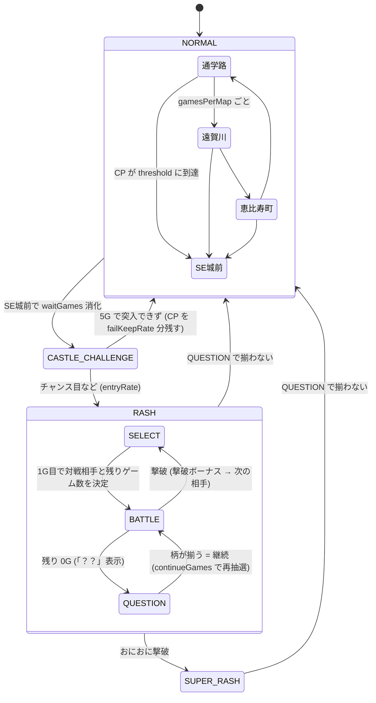

# CRこおりくんの大冒険 ～おにおにの野望～

主人公「こおりくん」が、ラスボス「おにおに」を倒すために SE城 を目指すスロットゲーム。
`slot/` の原型をもとに、液晶演出とゲーム性に特化して作り直している。

## 遊び方

- `index.html` をブラウザで直接開く（サーバー不要）
- レバー: **Space** / STOP: **J / K / L**（⚙ SETTINGS で変更可）
- `js/config.js` の `debug: true` で、画面下にデバッグパネル（状態の表示・強制遷移ボタン）が出る

## ファイル構成

| ファイル | 役割 |
|---|---|
| `howto.html` | 遊び方ページ（操作・ゲームの流れ・役と確率・対戦相手・設定。数値は `config.js` から自動で表示） |
| `js/config.js` | **調整用の数値すべて**（設定・確率・CP・ポイントチャンス・HP・ダメージ・ボーナス・演出） |
| `js/sprites.js` | キャラクターのドット絵データ（1文字=1ドット）と描画関数 |
| `js/backgrounds.js` | マップ背景のドット絵（レイヤーごとに描いて横スクロール） |
| `js/audio.js` | 効果音 |
| `js/state.js` | 状態（モード・マップ・フラグ）と状態遷移、1ゲームごとの状態更新 |
| `js/lottery.js` | 抽選（役の決定・出目の生成・重み付き抽選） |
| `js/battle.js` | RASH / BATTLE（対戦相手・ダメージ・撃破ボーナス） |
| `js/reels.js` | リール制御 |
| `js/lcd.js` | 液晶演出（canvas に描画） |
| `js/ui.js` | ステータス表示・キーボード操作・設定画面・デバッグパネル |
| `js/save.js` | データの保存と読み込み |
| `js/bgm.js` | BGM（曲データと再生） |
| `js/main.js` | 起動と1ゲームの流れ |
| `tools/simulate.html` | 出玉シミュレーター（設定ごとの出玉率などを計測） |

`config.js` が `.json` ではなく `.js` なのは、`index.html` を直接開いたときにブラウザの制限で `.json` を読み込めないため。中身はデータのみ。

## 1ゲームの流れ

```
レバーON → コイン投入 → Lottery.draw (役と出目を決定)
→ Reels.spin (STOPで停止) → 払い出し
→ GameFlow.onGameEnd (状態を更新し events を返す)
→ Lcd / UI が events と state を見て演出・表示
```

状態を書き換えるのは `state.js` と `battle.js` だけ。演出側は state を読むだけにしている。

## 状態遷移



- `SUPER_RASH` の中の流れは `RASH` と同じ（継続率 93%、対戦相手にゴールド金面犬が追加）
- 継続率は **セットの開始時に先に決める**（`rash.setWillWin`）。負けセットでは撃破しない範囲にダメージを抑え、「？？」で揃わない出目にする

### 管理している状態

| 項目 | 場所 |
|---|---|
| モード（NORMAL / CASTLE_CHALLENGE / RASH / SUPER_RASH） | `state.mode` |
| マップ・ループ位置・マップ内ゲーム数 | `state.normal.map` / `loopIndex` / `gamesInMap` |
| チャンスポイント | `state.normal.chancePoint` |
| SE城前の待機ゲーム数 | `state.normal.castleWaitRemaining` |
| 城突入チャレンジの残りゲーム数 | `state.challenge.gamesRemaining` |
| RASH のフェーズ（SELECT / BATTLE / QUESTION） | `state.rash.phase` |
| 対戦相手・HP・残りゲーム数 | `state.rash.enemyId` / `enemyHp` / `gamesRemaining` |
| 撃破回数（1回の RASH 内） | `state.rash.defeatCount` |
| おにおに出現フラグ | `state.rash.oniUnlocked` |
| ゴールド金面犬フラグ・次の相手確定 | `state.rash.goldDogFlag` / `nextForcedEnemy` |
| 柄揃い確率アップ | `state.rash.probUpGames` / `probUpMultiplier` |

## 設定ファイルの項目（`js/config.js`）

| 項目 | 内容 |
|---|---|
| `coins` | 1ゲームのコイン数、開始コイン、購入金額・枚数 |
| `reels` | 図柄の並び、払い出し枚数、チャンス目の出目 |
| `lottery.normal / castleChallenge / battle` | 状態ごとの役の確率 |
| `chancePoint` | 1ゲームごとの加算、チャンス目・柄揃いの追加加算、SE城前への規定値 |
| `map` | ループ順、マップ名、1マップの滞在ゲーム数 |
| `castle` | SE城前の待機ゲーム数、チャレンジのゲーム数、出目ごとの突入率、失敗時に残す CP の割合 |
| `rash` | 継続率（通常 / SUPER）、初期・継続時のゲーム数テーブル、おにおに出現に必要な撃破数 |
| `damage` | 柄ごとのダメージ（7 は確定撃破） |
| `enemies` | 敵ごとの出現の重み（通常 / SUPER）、HP、撃破ボーナス |
| `goldDog` | ゴールド金面犬の出現確率・HP・ボーナス・撃破後の確定相手 |
| `effects` | 液晶の解像度、演出の時間、画面揺れの強さ、カットイン率 |
| `keys` | キー割り当ての初期値 |

## マップ背景（ドット絵）

| マップ | 内容 |
|---|---|
| 通学路 | 朝の住宅街。家・学校・電柱と電線・歩道・横断歩道 |
| 遠賀川 | 山並み・赤い鉄橋・川・土手の道と草花 |
| 恵比寿町 | 夕焼けの商店街。看板・のれん・店先の品物・提灯・石畳 |
| SE城前 | 夜。月と星・赤く光る城（家紋「SE」）・石垣・たいまつ（炎が揺れる） |

通常時はこおりくんが歩き、背景は奥ほどゆっくりスクロールする（SE城前では立ち止まる）。
マップ切り替えは左右からのワイプ＋マップ名表示、SE城前への移動は赤いフラッシュ＋上下の黒帯＋「SE城が見えてきた！」。

## 城突入チャレンジ

- SE城前で `castle.waitGames` を消化すると開始。`castle.challengeGames`（5G）の間、出目ごとの突入率 `castle.entryRate` で毎ゲーム判定し、当たったゲームで即突入
- 現在の数値での突入成功率は **約41%**（2万回のシミュレーション）。主にチャンス目（チャレンジ中 1/15、突入率100%）で突入する
- 成功: 門が開く → こおりくんが城へ → RASH へ（CP は 0 に戻る）
- 失敗: 「突入失敗…」→ CP を `castle.failKeepRate`（50%）残して通常時のマップへ
- 演出: 開始時に赤フラッシュ・画面揺れ・上下の黒帯＋「城突入チャレンジ!!」、こおりくんが門の前へ。外れたゲームは門に体当たりして「はじかれた！」。残りゲーム数は5つのランプで表示し、チャレンジ中はレバーが赤く光る

## おにおにRASH / BATTLE

- RASH の1ゲーム目（撃破後の次のゲームも）で、対戦相手（`enemies` の重み）と残りゲーム数（`rash.initialGames`）を決定
- BATTLE 中は柄ごとにダメージ（`damage`）。チャンス目は大ダメージ、7揃いは確定撃破、ベルはダメージなし
- 残り 0G で「？？」。柄が揃えば同じ相手・HP のまま継続（`rash.continueGames`）、揃わなければ RASH 終了
- 継続率はセット開始時に先に決める（`setWillWin`、確率は `presetRate`）。負けセットではダメージは HP が 1 残るまで（「ガード!」表示）、「？？」では揃わない
- シミュレーション（5000回）: セット継続率 69.9%、1回の RASH で平均 2.3 体と対戦・31 ゲーム、RASH 中のコイン収支は 1ゲームあたり +1.8 枚
- 演出: 突入時に赤い「おにおにRASH」ロゴ（SUPER は金色）と「RASH突入!!」、RASH 中は左上にロゴを常時表示。対戦相手ルーレット → 敵が登場し「VS ○○」。攻撃はこおりくんの体当たり＋白く光る・画面揺れ・ダメージの数字・HP バーが減る。大ダメージは白フラッシュと大きな揺れ、7揃いは「一撃必殺!!」。撃破は金フラッシュで敵が消える。「？？」は点滅表示

## ガード崩し・ブレイク

- 負けセットでは敵がガードし、ダメージは HP が 1 残るまで（「ガード!」表示）
- `damage` が `'kill'` の役（BAR揃い・7️⃣7️⃣7️⃣・7️⃣7️⃣BAR）はガードを崩して確定撃破（「ガードブレイク!!」）。7️⃣7️⃣BAR は BATTLE 中の役（`lottery.battle.sevenBar`、出目は `reels.specialPatterns`）
- `breakState.roles`（チェリー）が揃うと `breakState.rate`（25%）でブレイク状態。今の敵を倒すか RASH が終わるまで敵はガードできない（紫の「BREAK!!」、HP 枠に「BREAK」表示）
- ガード崩し・ブレイクで勝ちになる分を見込み、セット開始時の先決めの確率 `presetRate` を目標の継続率 `continueRate` より低くしている（通常 0.550 / SUPER 0.896）
- シミュレーション: 最終的な継続率は 通常 RASH 69.83%（13万セット）、SUPER 93.12%（11万セット）。調整しない場合は 80.1% / 95.5% になる
- ダメージ・確率・ブレイク率を変えたときは、シミュレーションで `presetRate` を合わせ直す

## 撃破ボーナス・おにおに・SUPER・ゴールド金面犬

- 撃破ボーナス（`enemies[].bonus`）: `coins` はその場で加算、`games` は次の BATTLE のゲーム数に上乗せ、`probUp` は指定ゲーム数の間リプレイ以外の揃い役の確率を `value` 倍
- おにおに: 1回の RASH で `rash.oniUnlockDefeats`（3）体撃破すると「おにおにが現れる…!?」→ 以降、重み付き抽選の候補に入る
- おにおに撃破で SUPERおにおにRASH へ（継続率 93%、背景とロゴが金色、`superStart` 演出）。SUPER 中はおにおにが常に候補（`rash.superOniAlwaysAvailable`）
- ゴールド金面犬: SUPER 中の対戦相手抽選ごとに `goldDog.prob`（1/100）。撃破で 2000 枚、次の相手はおにおに確定
- シミュレーション: SUPER のセット継続率 93.07%（3000回）、金面犬の出現 1/99、金面犬撃破後の次の相手は 10/10 でおにおに、撃破3体前のおにおに出現 0回
- Mr.SASAKI はユーザー指定で「黒人のイケイケな社員」（ハイトップフェード・ロイヤルブルーのスーツ・社員証・金の腕時計・指さしポーズ）

## リールと当たりライン

- 各リールに上段・中段・下段の3つの図柄が見える（3×3）。当たりは5ライン（上段・中段・下段・右下がり・右上がり）
- リール配列は左・中・右で別々（`reels.strips`、各21コマ）。同じ並びだと複数の段が同時に揃うため
- 役の抽選（確率）はこれまでどおり。当たった役に合う止まり位置を、起動時に全組み合わせ（21×21×21 = 9261通り）を分類した表から選ぶ（`ReelMap`、約30ms）
  - 揃い役: ちょうど1ラインだけ揃い、チャンス目にならない出目
  - チャンス目: どのラインも揃わず、指定のチャンス目が1つだけ出る出目
  - ハズレ: どのラインも揃わず、チャンス目にもならない出目（`effects.fakeReachRate` の確率で 7・BAR のリーチ目を含む出目を選ぶ = ガセリーチ）
- チャンス目（`reels.chancePatterns`）: スイカ崩れ・BAR崩れ・7崩れ（5ラインのどこでも）。`weight` で出やすさを指定
- 左リール中段チェリーはロングフリーズ専用のため、チェリーは中段では揃わない（上段・下段・斜めで揃う）
- リーチは2本止めた時点で判定。揃うラインのリーチと、`effects.reachSymbols`（7・BAR・スイカ）のリーチで演出が出る。液晶にリーチのライン名を表示
- 揃ったラインの図柄は金色、チャンス目の図柄はピンクに光る
- リール配列やチャンス目を変えたときは、起動時の確認（`Lottery.validate`）で「出目が用意できない役」があればエラーを表示する

## 宝物庫ゾーン

- RASH / SUPER の BATTLE 中、1ゲームごとに `treasure.rate`（1/100）で突入するゲーム数上乗せ特化ゾーン。「？？」になったゲームでは突入しない（撃破直後は突入する）
- `treasure.games`（5G）の間 BATTLE を中断（残りゲーム数は減らない）。専用の確率表 `treasure.lottery` で抽選し、揃った柄に応じて `gamesByRole` のゲーム数を次の BATTLE に上乗せ（リプレイ+1・ベル+2・チェリー/ダイヤ+3・スイカ+5・BAR/7・7・BAR+10・7+20）
- 終わると元の BATTLE（撃破直後なら次の相手の決定）に戻る。上乗せは「次のBATTLE +NG」と表示され、次の BATTLE 開始時に加算
- 演出: 金貨の山と宝箱の宝物庫（ドット絵）。揃うと宝箱が開いてコインが飛び出し「+NG」、残りゲームはランプで表示
- シミュレーション: BATTLE 中の約1/90で突入、1回あたり平均約12G上乗せ（調整前の確率表での値）

## お仲間チャレンジ

- 通常時（マップ移動中）に `companions.challengeRate`（1/60）で発生（ポイントチャンスと同じゲームでは起きない）。`successRate`（20%）で仲間が加わる
- 現れる仲間は `weight` の重み（やすさん60・たむさん30・だけさん10、弱い順）。すでに仲間の人は現れない
- 仲間の効果（`companions.members`）:

| 仲間 | 城突入率 | 追加ダメージ | 肩代わり |
|---|---|---|---|
| やすさん | ×1.15 | +2 | 15% |
| たむさん | ×1.3 | +4 | 25% |
| だけさん | ×1.5 | +6 | 40% |

  - 城突入率: 仲間全員分を掛け合わせて突入率に掛ける（上限100%）
  - 追加ダメージ: BATTLE でダメージが入るたびに仲間が追撃（負けセットのガードの上限は合計に対してかかる）
  - 肩代わり: 「？？」で揃わず RASH が終わるとき、一番強い仲間が確率で肩代わり → RASH 継続（新しいセット）、その仲間は離脱
- 仲間は RASH が終わると帰っていく（パーティが空になる）。保存データに含まれる
- 演出: 仲間候補が影で現れる →「仲間になって!!」→ 成功で姿が見えて仲間に（こおりくんの後ろについて歩く）/ 失敗で去っていく。BATTLE ではこおりくんの攻撃に続いて仲間が追撃、肩代わりは「○○がかばってくれた!!」
- 肩代わりのぶん、実際の RASH 継続率は 70% / 93% より少し高くなる
- 3人ともオリジナルデザインのドット絵（やすさん: 眼鏡・青いパーカー、たむさん: 赤い帽子・緑のジャケット、だけさん: ハチマキ・オレンジのタンクトップ）

## ロングフリーズ

- どのモードでも1ゲームごとに `longFreeze.prob`（1/8192）で当選（他の役より先に抽選）。出目は左リール中段にチェリー（`longFreeze.cells`、この出目はロングフリーズ専用）
- 左リールが止まった瞬間に発生: 画面が止まる（BGM も停止）→ ノイズ → 暗転 → 虹色の「こおりいきていける！」とこおりくんが虹色に光る。演出中は STOP を押せず、筐体の枠が虹色に。演出後に残りのリールを止める
- 効果:
  - 通常時・城突入チャレンジ: おにおにRASH へ（最初の相手はおにおに）
  - おにおにRASH: 戦闘中の敵を完全撃破（撃破ボーナスあり）→ `superRate`（75%）で SUPER 直行、25% で次の相手がおにおに。おにおにと戦闘中なら撃破でそのまま SUPER
  - SUPERおにおにRASH: 戦闘中の敵に勝利 → 次の相手はゴールド金面犬
- デバッグパネルの次の出目「ロングフリーズ」で確認できる

## ポイントチャンス

- 通常時（マップ移動中）に 1ゲームごと `pointChance.rate`（1/30）で発生。SE城前・城突入チャレンジ中は発生しない
- こおりくんの頭上に「少ないポイント」（`small` から1つ）と「多いポイント」（`big` から1つ）の吹き出しが左右ランダムに出て、カーソルが行き来したあと、こおりくんがジャンプして片方を選ぶ
- どちらを選ぶかはそのゲームの出目で決まる（`bigRate`: チャンス目 90%・BAR 80%・スイカ 60%・チェリー 50%・ダイヤ 35%・ベル 20%・リプレイ 15%・ハズレ 10%。設定で倍率がかかる）
- 選んだポイントをチャンスポイントに加算

## 台の設定（1〜6）

- 起動時に `machine.weights` の重みで抽選（設定1: 40% … 設定6: 4%）。⚙ SETTINGS の「台の設定」で「表示する」を押すと確認できる
- 設定で変わるもの（`machine.multipliers`）: 通常時・城突入チャレンジ中のチャンス目の確率、城突入率、ポイントチャンスで「多い」を選ぶ確率。RASH の継続率は仕様どおり固定

## 出玉バランス

`tools/simulate.html` をブラウザで開いて「実行」を押すと、`js/config.js` の数値で設定ごとに自動プレイして出玉率などを表示する（設定ごと 500万ゲームで約15秒）。

調整後の計測結果（設定ごと 500万ゲーム）:

| 設定 | 出玉率 | RASH 初当たり | 城突入成功率 | RASH 平均獲得 | SUPER 到達率 |
|---|---|---|---|---|---|
| 1 | 99.1% | 1/175 | 33% | 302枚 | 6.3% |
| 2 | 99.8% | 1/165 | 35% | 288枚 | 5.7% |
| 3 | 103.1% | 1/160 | 37% | 299枚 | 6.2% |
| 4 | 104.7% | 1/150 | 40% | 291枚 | 5.8% |
| 5 | 108.7% | 1/137 | 45% | 287枚 | 5.6% |
| 6 | 111.8% | 1/126 | 49% | 279枚 | 5.5% |

- 目標は設定1 約97% 〜 設定6 約112%。計測のたびに ±1% 程度ぶれる
- 主な調整: おにおにの出現の重み（候補入り後）3→20 / SUPER 中 8→15、おかがっぱの撃破ボーナス 50→35枚、Mr.SASAKI 150→120枚、おにおに 300→250枚、RASH 中のリプレイ 1/2→1/2.2（お仲間チャレンジ追加で上がった分も含めて調整）、設定差の倍率、城突入チャレンジ中のチャンス目 1/15→1/24（ロングフリーズ追加で上がった分も含めて調整）、BATTLE 開始時のゲーム数の振り分けを短め寄りに（宝物庫ゾーン追加で上がった分の調整）
- SE城前への規定値はユーザー指定で 100 ポイント（112 から戻した分を城突入チャレンジ中のチャンス目で調整）
- 通常時（城突入チャレンジ含む）だけの出玉率は約54%。出玉の多くは RASH から

## データの保存

- 1ゲーム終了ごと（コイン購入・デバッグ操作のあとも）に、ゲームの状態を丸ごとブラウザ（localStorage）に保存（`js/save.js`）
- 次に開くと続きから遊べる（コイン・統計・台の設定・マップ・CP・城突入チャレンジや RASH の途中経過も含む）。液晶に「CONTINUE!」と表示
- ⚙ SETTINGS の「データ」で最後に保存した時刻を表示
- 画面上部の「↺ リセット」（または ⚙ SETTINGS の「ゲームをリセット」）→ 確認ダイアログで「リセットする」を押すと、保存データを消して最初から（台の設定も抽選し直し）。キー割り当て・サウンドの設定は残る。リールの回転中・演出中は押せない
- 回転中にページを閉じた場合、そのゲームは保存されない（投入したコインも戻る）
- 保存できない環境（プライベートブラウズなど）でも、保存なしで遊べる

## BGM

- Web Audio で鳴らすチップチューン（`js/bgm.js`。メロディは矩形波、ベースは三角波）
- 場面ごとに4曲: 通常時（明るい行進）、SE城前・城突入チャレンジ（不穏）、おにおにRASH（速いバトル曲）、SUPERおにおにRASH（ファンファーレ風）
- 最初のクリックかキー入力で鳴り始める（ブラウザの自動再生の制限のため）
- ⚙ SETTINGS の「サウンド」で BGM のオン・オフと音量を変更（ブラウザに保存）
- 曲は `BGM_TRACKS` に音名（例: `'C5'`、休符は `'.'`）を8分音符単位で並べて定義

## 演出（段階6）

| 演出 | 内容 | 設定 |
|---|---|---|
| 図柄のドット絵 | 7種類（チェリー・レモン・スイカ・ベル・ダイヤ・7・BAR）を 32x32 ドットで描画（`SYMBOL_ART`） | ― |
| リーチ | 2本止まった時点で柄が揃っていれば「REACH!」と柄を表示、残りの STOP が赤く光る。3本目で「GET!!」「CHANCE!!」「NO...」 | ― |
| ガセリーチ | ハズレのとき一定確率でリーチ目にして「NO...」 | `effects.fakeReachRate` |
| 押せ!! | チャンス目のとき一定確率で最後の STOP が金色に光る | `effects.pushRate` |
| 先読み予告 | レバー ON で雪が降る（金色の雪は当たり役のみ） | `effects.preview` |
| カットイン | 7リーチ（こおりくん）、大ダメージ（こおりくん）、おにおに・ゴールド金面犬の登場 | `effects.cutInRate` |
| ボタン・筐体 | 城突入チャレンジ中はレバーが赤、「？？」はレバーが金色に光る。筐体の枠は RASH 中は赤、SUPER 中は金 | ― |

## 決定済みの仕様

| 項目 | 決定内容 |
|---|---|
| 城突入失敗時 | 通常時に戻り、CP を一部残す（`castle.failKeepRate`） |
| 「？？」から継続時のゲーム数 | 抽選テーブル（`rash.continueGames`） |
| 撃破回数の範囲 | 1回の RASH 内でリセット |
| SUPER の終了 | 通常 RASH と同じく「？？」で揃わなければ終了 |
| ゴールド金面犬の出現率 | SUPER 中の対戦相手抽選ごとに 1/100 |
| おにおにの出現 | 撃破3回以降、重み付き抽選の候補に入る |
| ひびきまくり・ゴールド金面犬の見た目 | `my-project/` 直下の画像をもとにドット絵化 |

## 進捗

| 段階 | 内容 | 状態 |
|---|---|---|
| 1 | 設定ファイルと状態管理の骨組み | ✅ 完了 |
| 2 | 通常時（マップループ・チャンスポイント）＋マップ背景のドット絵 | ✅ 完了 |
| 3 | SE城前と城突入チャレンジ | ✅ 完了 |
| 4 | おにおにRASH と BATTLE | ✅ 完了 |
| 5 | 撃破ボーナス・おにおに出現・SUPER・ゴールド金面犬 | ✅ 完了 |
| 6 | 演出の作り込み（図柄のドット絵・リーチ・カットイン・先読み・ボタン連動） | ✅ 完了 |

## 未実装項目

- スマホ向けのレイアウト調整、タッチ操作の最適化

## 未確定事項

- 「？？」から継続したとき、対戦相手と HP をそのまま引き継ぐか（現在の予定: 引き継ぐ）
- SUPER 中のおにおにの出現条件（現在の予定: 常に候補に入る `rash.superOniAlwaysAvailable`）
- RASH 中のリプレイ（🍋）揃いでダメージを与えるか（現在: 5 ダメージ。「ベル以外の柄」に従った）
